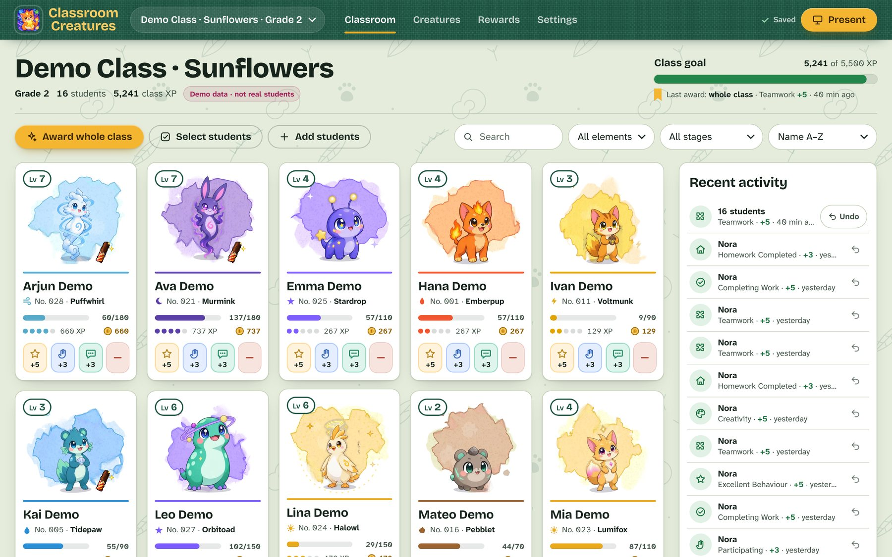
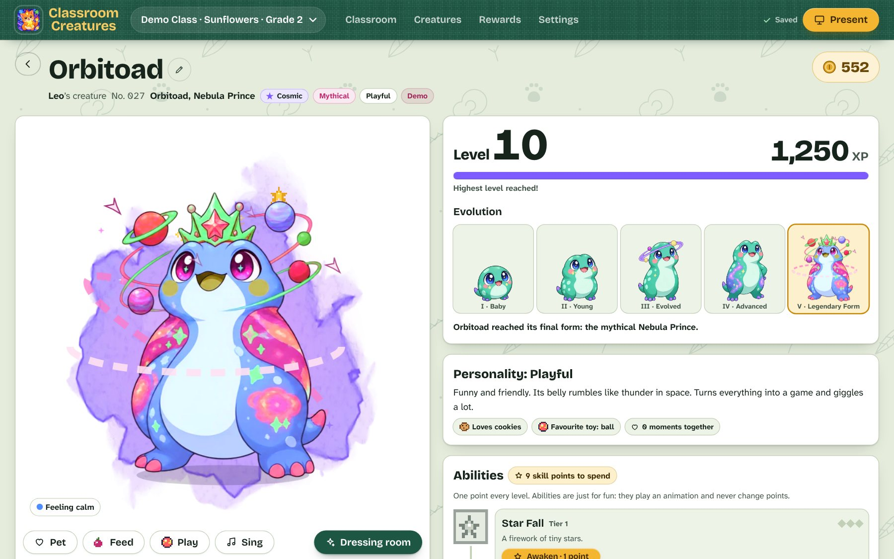
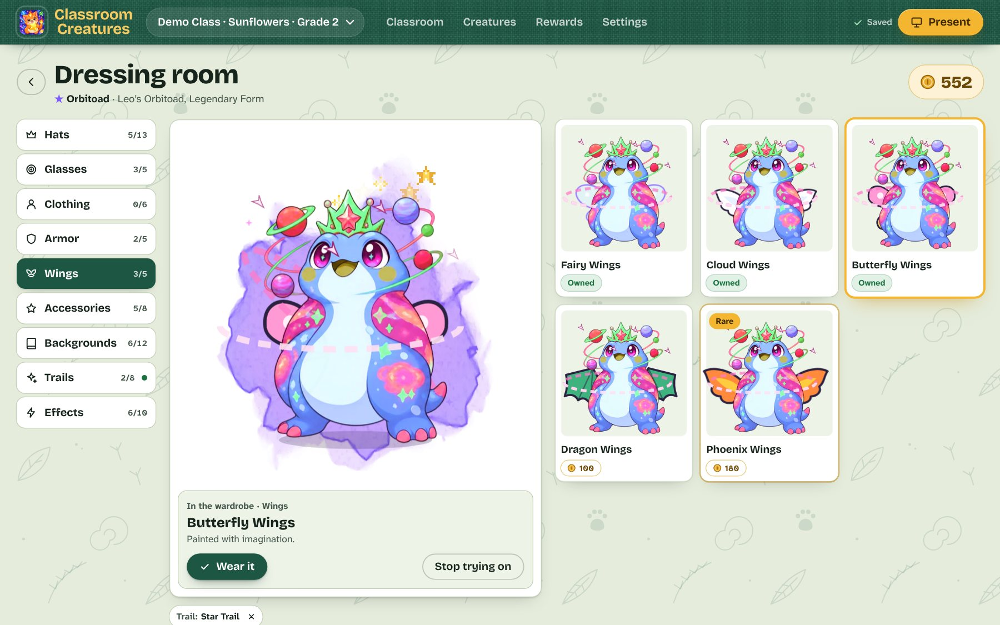
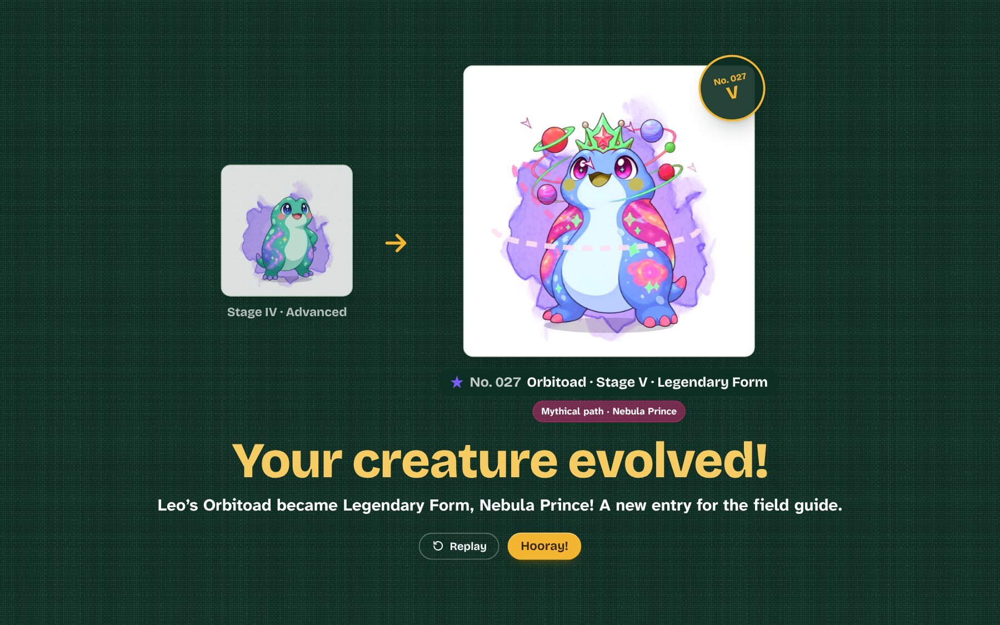
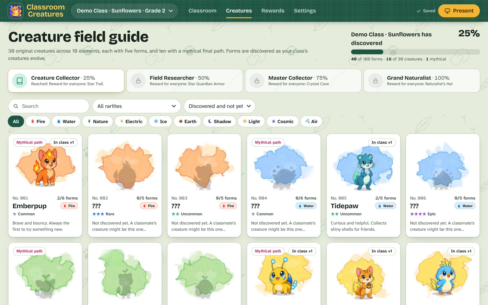
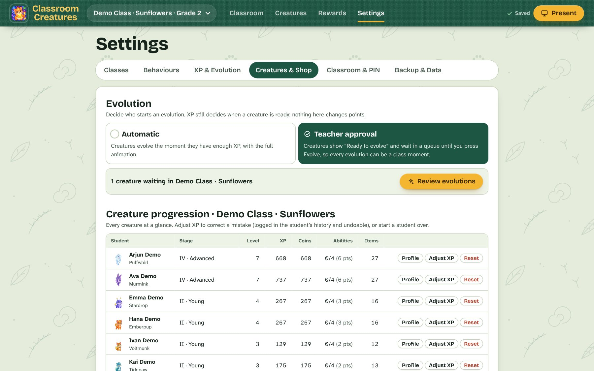
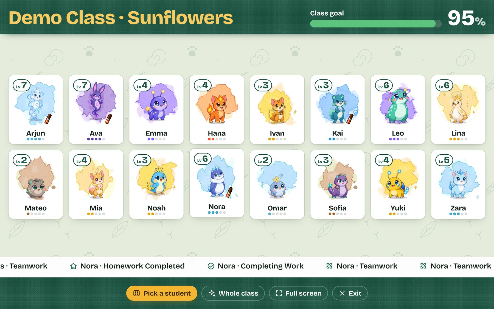
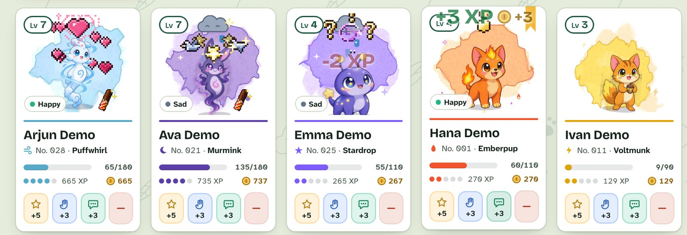

# Classroom Creatures

A gamified classroom management app for Grade 2 and Grade 3 teachers. Every student gets their own original fantasy creature. The teacher awards XP for positive behaviour, and the creatures celebrate, level up and evolve through five forms (ten of them can take a mythical final path). Students dress their creature up with the coins they earn, awaken its abilities and play with it, and the class fills in a field guide of every form it discovers. It all shows on a projector-friendly presentation screen.

- **Runs locally.** No accounts, no student emails, no cloud, no paid services. Works offline once installed.
- **Saves automatically** to the browser's IndexedDB (with a localStorage mirror), plus daily safety snapshots and downloadable backup files.
- **Kind by design.** Behaviour deductions take XP only, never coins; they never go below 0 XP, never undo an evolution, and students never lose their creature. There are no public rankings.


<p align="center"></p>

| Creature profile | Dressing room | Evolution |
|---|---|---|
|  |  |  |

| Field guide | Teacher controls | Presentation mode |
|---|---|---|
|  |  |  |

<p align="center"></p>

## What's new in 1.4: the creature RPG update

- **Evolution can be a class moment.** Choose **Automatic** (creatures evolve as soon as they have the XP) or **Teacher approval** in Settings → Creatures & Shop. With approval on, a ready creature shows **Ready to evolve** and joins the **Evolutions** queue on the Classroom tab until you press **Evolve**. The evolution itself is a full-screen sequence: the creature turns to light under a pixel pillar, a flash, then the new form beside the old one, with its own sounds. Every evolution is kept in the creature's history, and evolving never changes XP or coins.
- **Two final paths.** Ten creatures choose at stage V between their classic Legendary form and a **Mythical** form with its own colours, ornaments and drifting pixel particles. The field guide counts both.
- **A dressing room for every creature.** 73 items in nine slots: hats, glasses, clothing, armor, wings, accessories, backgrounds, trails and effects. Students try anything on before buying, see what they own, what they are wearing, what is locked and what it costs, and buy with their own coins. There are rare items and seasonal ones (a Blossom Crown in spring, Summer Shades, an Autumn Leaf Crown, a Snowflake Scarf in winter) marked with how long they stay. Nothing is random: no loot boxes, nothing bought twice, and coins never go below zero. Undoing an award never takes back something a student bought.
- **A creature profile.** One page per creature: the creature itself to pet, feed and play with (snacks and toys are free and just for fun), level and XP, the evolution line with progress to the next form, its personality (seven kinds, each with a favourite snack and toy), abilities, achievements and the forms it has revealed. Open it from a student's pop-up, the Presentation spotlight or the progression table.
- **Abilities.** Every creature has four: two from its element, a signature move, and an ultimate that depends on its final path. Each has three ranks, and a creature earns one skill point per level. Abilities only play an animation; they never change points or give anyone an advantage.
- **The class field guide.** All 160 forms (30 creatures × 5 stages, plus the 10 mythical forms). Forms the class has not met yet are silhouettes. Search by name and filter by element, rarity or discovery. When the class discovers 25%, 50%, 75% and 100% of the guide, everyone gets a reward (Star Trail, Star Guardian Armor, Crystal Cave background, Naturalist's Hat).
- **Creature achievements**, each with its requirement and, where it has one, a reward: First Evolution, Evolution Master, First Legendary, Mythical Path, Customization Expert, Wardrobe Collector, Ability Adept, Ability Master, Best Friends, Creature Collector, Field Researcher, Master Collector and Grand Naturalist.
- **Teacher controls** in Settings → Creatures & Shop: the evolution mode and queue, a progression table for the class, **Adjust XP** to fix a mistake (logged in the student's history, undoable, never touches coins), **Reset progress** for one student (you type their name to confirm, and a safety snapshot is saved first), which creatures new students can get, and which items are offered and at what price.
- **Students can use their own creature while you stay locked.** From Presentation Mode, students can open their creature's profile and dressing room while teacher controls are locked. They can play, awaken abilities and spend their own coins, but they can never change XP or coins. Switch this off in Settings → Creatures & Shop.
- **Sound settings.** A volume slider, optional button clicks, and new sounds for evolving, buying, dressing up, abilities, snacks and toys. Everything still follows the **Sound effects** switch.
- **The paintings come alive.** Every painted creature blinks, each on its own rhythm with the odd double blink, so a class never blinks in unison; sleepy creatures doze with their eyes shut, and big views add a slow breath under each species' idle movement. Blinking and breathing stop with *Reduce motion*.
- **Starts faster.** Screens and pixel effects now load the first time they are needed.
- **Your data comes with you.** 1.3 data upgrades automatically when you open 1.4 (a safety snapshot is saved first). Students keep their creature, XP, coins, stage, items and history, and existing classes stay on Automatic evolution.

## What's new in 1.3

- **A new look: the creature field guide.** The dark purple night sky is gone. The app is now a naturalist's field guide for your class, built for a projector in a bright classroom: a light endpaper background printed with faint tracks and leaves, a bookcloth-green header, and dark ink text that stays readable from the back of the room.
- **Every creature has its own painted plate.** Each species sits on a watercolour wash in its element's colour and carries a field number (No. 001 to No. 030) that is the same on student cards, in the Creature field guide and in profiles.
- **See who was just rewarded.** Cards in the latest award keep a marigold ribbon until you give the next one. Marigold is used only for what is happening now: selected students, the current tab, the main action.
- **Bigger numbers where the class looks.** Presentation Mode shows the class goal as a large percentage, and profiles show level and XP at a size you can read across the room.
- New fonts (Bricolage Grotesque for headings, Atkinson Hyperlegible Next for everything else, both bundled for offline use) and a drawn icon set for every button.

## What's new in 1.2

- **Pixel art effects** from the [pixelfx](https://github.com/dark3panther/pixelfx) library (MIT, vendored in `src/vendor/pixelfx`), played live on top of every creature:
  - *Positive:* a sparkle burst and a "!" emote on every award, a **LEVEL UP!** banner, a power star for badges, a sunburst when a milestone treat is earned.
  - *Negative:* a pixel **BONK!**, then a status effect that matches the behaviour: dizzy stars and birds (talking without permission, moving around), a slow-down clock (task not finished), question marks (not listening).
  - *Emotes for moods:* pixel hearts (happy), a sparkling light beam (excited), a halo (proud), Zzz (sleepy), plus the rain cloud (sad).
- **A pixel chocolate stick.** When a student earns a Choki Choki milestone, their creature appears holding a pixel chocolate stick (an original drawing in a red and yellow striped wrapper, no brand logo) until you tick **Given ✓** in Rewards. Several waiting treats show a ×2, ×3 badge.
- **Earned accessories are worn automatically** in any empty slot, so creatures show off new hats, glasses, wings and decorations straight away.

## What's new in 1.1

- **New app icon** (made with Higgsfield).
- **Coins and a shop.** Students earn 1 coin for every positive XP point (adjustable). In a student's profile, **Shop** sells outfits (T-shirt, hoodie, overalls, party dress, super suit, raincoat), hats, heart glasses, a bow tie, a necklace, dragon wings, a bubble aura and new backgrounds. Bought items are worn from **Wardrobe**.
- **Milestone rewards.** Every 100 XP a student earns a **Choki Choki chocolate** (change the treat, the amount or add more milestones in Settings → Classroom & PIN). A popup tells you who earned one, and **Rewards → Milestone rewards to hand out** keeps the list until you tick **Given ✓**.
- **Behaviour deductions.** Talking Without Permission (−2), Moving Around (−2), Task Not Finished (−3), Not Listening to Instructions (−2), from the grey **−** button on each card or the award list. The creature gets a cartoon **BONK!**, dizzy stars and a sad rain cloud for a while. Deductions take XP only, never coins, never go below 0 XP and never undo an evolution.
- **Creature emotions.** Each creature feels **happy** after points, **excited** after several in a row, **proud** after a milestone, **sad** after a deduction, **sleepy** when ignored for a few days, and **calm** otherwise. Moods show on cards, profiles and in Presentation Mode (hearts, sparkles, rain cloud, Zzz, crown).
- **Class goal prize wheel** ([screenshot](docs/screenshots/prize-wheel.jpg)). When the class reaches its XP goal, everyone spins the wheel: funny video, gaming class, movie class, Choki Choki for everyone, extra playtime or a music & dance party (editable). The next goal is set automatically.
- **Livelier creatures.** Element particles drift around every creature (embers, bubbles, leaves, sparks…). In the profile and Presentation spotlight, creatures lean towards your pointer, react when tapped, and **press and hold to pet** them for hearts.
- Data from 1.0 upgrades automatically: students start with coins equal to the XP they already have, and past milestones count as already handed out.

## Quick start

Requires [Node.js](https://nodejs.org/) 18 or newer.

```bash
npm install
npm run dev
```

Open the address it prints (usually http://localhost:5173). On first launch a clearly labelled **demo class** is loaded so you can try everything; the welcome screen offers to set up your real class and a teacher PIN.

### Using it every day without the dev server

```bash
npm run build
npm run preview
```

`npm run build` writes a static site to `dist/`. It uses relative paths, so `dist/` can be served by any static web server (for example `npx serve dist`) or copied to a school intranet. Data is stored per browser *and* per address, so always open the app from the same address on the same computer.

### Mac app

Classroom Creatures also runs as a normal Mac app (a dock icon, its own window, native full screen for the projector, menu shortcuts ⌘1–⌘3 for the tabs, ⌘, for Settings and ⌘P for Presentation Mode). It works fully offline.

**Easiest: build it on your Mac** (needs Node.js 18+):

```bash
npm install
npm run app:mac
```

This creates `release/Classroom Creatures-<version>-universal.dmg` (works on both Apple Silicon and Intel Macs). Open the `.dmg` and drag **Classroom Creatures** into **Applications**.

**Or download it:** grab the latest `.dmg` from this repository's **Releases** page. Every push to `main` also builds it (the *macOS app* workflow on the **Actions** tab, artifact `Classroom-Creatures-mac`), and a Release is published either by pushing a tag such as `v1.4.0` or from **Actions → Release → Run workflow** with the version number (the tag is created for you).

**First launch of a downloaded copy:** the app is not notarised by Apple (that needs a paid Apple Developer account), so macOS warns you the first time. Right-click (or Control-click) the app in Applications → **Open** → **Open**. On recent macOS versions you may instead need to go to System Settings → Privacy & Security and click **Open Anyway**. If macOS says the app "is damaged", run this once in Terminal:

```bash
xattr -cr "/Applications/Classroom Creatures.app"
```

**Your data in the Mac app** is stored in `~/Library/Application Support/Classroom Creatures`, separately from any browser copy. To move a class from the browser version into the app, use Settings → Backup & Data → *Download backup file* in the browser, then *Restore from file* in the app.

To try the desktop shell without packaging: `npm run app`. The same config also builds Windows (`npx electron-builder --win`) and Linux (`npx electron-builder --linux`) versions.

### Other commands

| Command | What it does |
|---|---|
| `npm run dev` | Development server with hot reload |
| `npm test` | Unit tests for the XP, evolution, shop, ability, achievement, challenge, import, backup and storage code (Vitest) |
| `npm run test:e2e` | End-to-end check in a real browser: the 1.3 to 1.4 upgrade, playing with a creature, abilities, buying an item, a teacher-approved evolution, the field guide, locked student mode, persistence after a restart, and phone width. Needs Playwright (`npm i -D playwright && npx playwright install chromium`); `E2E_SHOTS=out` also saves screenshots |
| `npm run typecheck` | TypeScript check |
| `npm run build` | Type-check and build the production site into `dist/` |

## Classroom workflow

1. **Classroom tab**: every student card shows the creature, level, XP bar, stage and three quick-award buttons (the behaviours you ⭐ pin in Settings).
2. **Click a card** to open the student pop-up: a big animated creature, the full award grid, what the creature is wearing, badges, challenge progress, history and management tools. **Creature profile** opens the creature's full page, with the **Dressing room** one tap away.
3. **Select students** to award several at once, or **Award whole class**.
4. Every award shows a floating **+XP**, a chime and a creature celebration. Level-ups, achievements and evolutions trigger their own celebrations automatically.
5. **Made a mistake?** Every award shows an **Undo** toast for 10 seconds, and any award can be undone later from the activity panel or the student's History tab. Undo also takes back badges or items that award unlocked.
6. **Evolutions** (with Teacher approval on) lists the creatures ready to evolve. Press **Evolve** for one, or **Evolve all**; a creature at its last stage with two paths asks which one to take.
7. **Present** opens a full-screen projector view: first names and creatures only (no XP totals, no rankings), a class-goal bar, an awards ticker, a spinning random student picker and a big spotlight view.

## Project architecture

```
src/
├── types.ts                 Domain types (AppData is everything that is persisted)
├── data/                    Pure content: species, elements, defaults, achievements, items, challenges,
│                            final paths (branches.ts), abilities and personalities
├── engine/                  Pure, unit-tested game logic (no React, no storage)
│   ├── progression.ts       XP → level → stage, next-evolution targets, readiness, table validation
│   ├── awards.ts            applyAward / undoBatch / unlock evaluation / challenge progress / purchases
│   ├── evolution.ts         Approval queue, one-stage evolutions, final-path choice, evolution history
│   ├── collection.ts        Forms revealed, class discoveries, field-guide statistics
│   ├── abilities.ts         Skill points, ability ranks and the ability tree view
│   ├── shop.ts              Item states (owned, wearing, buyable, locked, seasonal), prices, buying
│   ├── roster.ts            Unique creature assignment, student/class factories, CSV/name parsing
│   ├── backup.ts            Backup file format, validation, normalisation and step-wise data migrations
│   ├── demo.ts              Clearly labelled demo class
│   └── pin.ts               Salted SHA-256 PIN hashing
├── store/
│   ├── store.ts             Zustand store: actions call the engine, queue celebrations, auto-save
│   └── storage.ts           IndexedDB persistence, localStorage mirror, rolling snapshots
├── creatures/
│   ├── CreatureSvg.tsx      Parametric SVG renderer for all species × 5 stages
│   ├── accessories.tsx      Hats, glasses, wings, magic, decorations
│   ├── Creature.tsx         Animated wrapper: idle loop, reactions, particle bursts
│   ├── Burst.tsx            One-shot element/sparkle/confetti particles
│   ├── Habitat.tsx          Element habitats, unlockable backgrounds and painted pixel scenes
│   ├── PixelFx.tsx          Plays pixelfx effects on one shared animation clock, loading each on first use
│   ├── pixel.tsx            Pixel sprites (snacks, toys, ability icons) and trail particles
│   └── mythic.tsx           Colour grade and ornaments for the mythical final forms
├── (electron/main.cjs)     Desktop shell: serves dist/ from a private app:// origin, menus, full screen
├── audio/sfx.ts             All sounds synthesised with Web Audio (original, offline)
├── components/              Cards, award grid, celebrations, toasts, top bar, PIN lock, UI kit
├── views/                   Dashboard, StudentProfile, CreatureProfile, Customize (dressing room), Creaturedex
│                            (field guide), Rewards, Settings, TeacherCreatures, Present, Onboarding
└── lib/                     Hash router and view-model helpers
```

**Data flow.** UI → store action → pure engine function returns a new `AppData` → store commits it (debounced save to IndexedDB) and pushes UI-only celebration events (evolution, level-up, achievement, class goal) to a queue that `CelebrationHost` plays one at a time.

**Ready for cloud sync later.** All persisted state is one serialisable `AppData` object with a `version` field, every record has a stable id, and awards are an append-only event log with batch ids. A sync backend can replicate `AppData` (or the event log) without changing the UI or the engine.

## Creature artwork

Every creature has illustrated artwork for all five stages (150 images in `public/creatures/`, about 4 MB). The art was generated with Higgsfield (GPT Image 2.5): one transparent image per species showing its whole five-stage evolution line, written from that species' design data and reviewed by hand so every design stays original and doesn't resemble an existing franchise character. The prompts are generated by the data in `src/data/species.ts`.

- `scripts/slice-lineup.py <lineup.png> <id>` cuts a lineup into `<id>-1.webp` … `<id>-5.webp` (needs Python with Pillow, NumPy and SciPy).
- `scripts/creature-anchors.py` measures where each creature's head and eyes are and writes `src/data/creatureArt.json`, which is how hats, glasses and other accessories line up on the illustrations.
- **Mythical forms**: Frostflame Warden, Stormtide Herald and Nebula Prince are painted, generated with Google Gemini (Nano Banana Pro) from each species' own Legendary art, so the creature, pose and style carry over. The other seven are still drawn from the Legendary art with a colour grade and ornaments (`src/creatures/mythic.tsx`). To add a painting, put `public/creatures/<id>-5b.webp` (512×512, transparent, same height and floor line as `<id>-5.webp`) in place and run `scripts/creature-anchors.py`; the app picks it up automatically. If the measurement misreads an image, correct it in `scripts/creature-anchor-overrides.json`.
- The original vector drawings are still in the app. Teachers can switch to them in **Settings → Classroom & PIN → Illustrated creature art**, and any species without an illustration automatically uses them. Open `?sheet` in development to see the vector set, or `?sheet&art` for the illustrations.

## Adding new creatures

The vector version of a creature is drawn from parameters, so a new species works immediately with no image files (add illustrated art later with the scripts above). Add an entry to `RAW` in `src/data/species.ts`:

```ts
{ id: 'puddlepup', name: 'Puddlepup', legendTitle: 'Rain Herald', element: 'water', rarity: 'uncommon',
  personality: 'Splashes in every puddle it finds.', ability: 'Rain Dance',
  body: 'tall',        // round | tall | pear | wisp
  ears: 'droop',       // cat | bunny | round | fin | none | antenna | leaf | horn | feather | droop
  tail: 'fluffy',      // flame | fluffy | fish | leaf | bolt | none | curl | crystal | wisp | star | cloud
  wings: 'none',       // none | feather | bat | fairy | crystal | leaf
  face: 'snout',       // snout | beak | plain | whisker
  pattern: 'spots',    // none | belly | spots | stripes | stars | cracks | swirl
  idle: 'hop',         // bob | sway | float | hop | breathe | wiggle
  palette: { main: '#6fb7e8', shade: '#4a93c8', belly: '#e8f6ff', accent: '#ffd36b', eye: '#10233a' } },
```

- Each stage automatically grows the creature and adds its element's features (for example fire: flame tuft → horns → cheek flames → flame crown and embers).
- A short original "voice" is generated from the id; pass `sound: { base, wave, notes }` to customise it.
- To preview every species at every stage while developing, open `http://localhost:5173/?sheet` (or `?sheet=fire`, `?sheet=puddlepup`, and `&eq=hat:hat-crown,glasses:glasses-round` to try accessories). The sheet only exists in development builds.
- New body parts or element features go in `CreatureSvg.tsx` (`Ears`, `Tail`, `WingPair`, `ElementFeatures`). Accessories go in `accessories.tsx` plus an entry in `ITEMS` (`src/data/defaults.ts`).

## Adding animations

- **Idle loops** are CSS keyframes in `src/index.css` (`.idle-bob`, `.idle-hop`…), chosen per species with `idle`. They are cheap on classroom computers and switch off with *Reduce motion* or the OS setting. Large views add `.cc-breath` underneath.
- **Blinking** on the paintings: `scripts/creature-anchors.py` measures an eyelid per eye (size, the skin colour around it, a lash colour) into `src/data/creatureArt.json`, `Illustrated.tsx` draws the lids with a feathered rim, and `src/creatures/blink.ts` closes them for a moment on one shared timer (nothing animates between blinks). Where the measurement misreads an image, set the eye centres and half-sizes in `scripts/creature-anchor-overrides.json` and rerun the script. In development, `?sheet&art&lids` shows every form with its eyes shut.
- **Reactions** (jump, wave, ability, happy, celebrate) live in `src/creatures/Creature.tsx`: add a name to `CreatureAction` and a Framer Motion keyframe in `run()`.
- **Particles**: `Burst` in `src/creatures/Burst.tsx` takes an element kind, `sparkle` or `confetti`; add a particle shape in `Particle`.
- **Big moments**: the evolution sequence, level-up, achievement and class-goal celebrations are in `src/components/Celebrations.tsx`.

## Changing XP progression

Teachers can edit the level table and evolution levels in **Settings → XP & Evolution** (validated; nobody loses badges or items). The defaults live in `src/data/defaults.ts`:

| Level | 1 | 2 | 3 | 4 | 5 | 6 | 7 | 8 | 9 | 10 |
|---|---|---|---|---|---|---|---|---|---|---|
| Total XP | 0 | 50 | 120 | 210 | 320 | 450 | 600 | 780 | 980 | 1200 |

Evolution: Baby (L1), Young (L3), Evolved (L5), Advanced (L7), Legendary Form (L10). Whether creatures evolve as soon as they reach the level or wait for you is set in **Settings → Creatures & Shop**. Behaviour XP values are edited in **Settings → Behaviours**. Achievement rules and item unlock rules are data in `src/data/defaults.ts`.

## Backing up and restoring data

- **Automatic**: every change is saved immediately on this computer. A safety snapshot is taken once a day and before anything is deleted, removed, reset, restored or upgraded to a new version (the newest 12 are kept).
- **Backup file**: Settings → Backup & Data → *Download backup file*. Keep it on a USB stick or school drive (once a week is a good habit).
- **Restore**: *Restore from file* (or pick a snapshot). Your current data is snapshotted first, so a restore can itself be undone.
- **Moving to a new computer**: download a backup on the old one, open the app on the new one, restore the file.
- Backups never contain the teacher PIN. **Forgot the PIN?** Clear this site's data in the browser, open the app, and restore your latest backup file.

## Privacy

Only first names (or whatever the teacher types) are stored, and only on this computer. There are no student accounts, emails, analytics or network requests; fonts are bundled. Presentation mode shows first names only. Student deletion requires typing the student's name and takes a snapshot first.

## Credits

All creatures, names, artwork, animations and sounds are original to this project. Inspired by the general appeal of creature-collecting games and classroom point systems; no characters, artwork, sounds or branding from any existing game are used.

## Design documents

- [Architecture & development plan](docs/architecture-and-plan.md)
- [Visual reference analysis](docs/visual-reference-analysis.md)
- [Design system](docs/design-system.md)
- [Roadmap](ROADMAP.md)

## License

[MIT](LICENSE). The bundled [pixelfx](https://github.com/dark3panther/pixelfx) effects are MIT too (see `src/vendor/pixelfx/LICENSE` and `NOTICE.md`).
