# Classroom Creatures

A gamified classroom management app for Grade 2 and Grade 3 teachers. Every student gets their own original fantasy creature. The teacher awards XP for positive behaviour, and the creatures celebrate, level up and evolve through five forms (ten of them can take a mythical final path). Students dress their creature up with the coins they earn, awaken its abilities and play with it, and the class fills in a field guide of every form it discovers. It all happens in a bright, animated painted sky world, and shows on a projector-friendly presentation screen. In the World of Adventures the class explores six pixel-art regions together: daily and weekly quests, cooperative boss battles where nobody is ever out, treasure chests that say exactly what is inside, a journal for every student and a class world they build up together.

- **Runs locally.** No accounts, no student emails, no cloud, no paid services. Works offline once installed.
- **Saves automatically** to the browser's IndexedDB (with a localStorage mirror), plus daily safety snapshots and downloadable backup files.
- **Kind by design.** Behaviour deductions take XP only, never coins; they never go below 0 XP, never undo an evolution, and students never lose their creature. There are no public rankings.


<p align="center">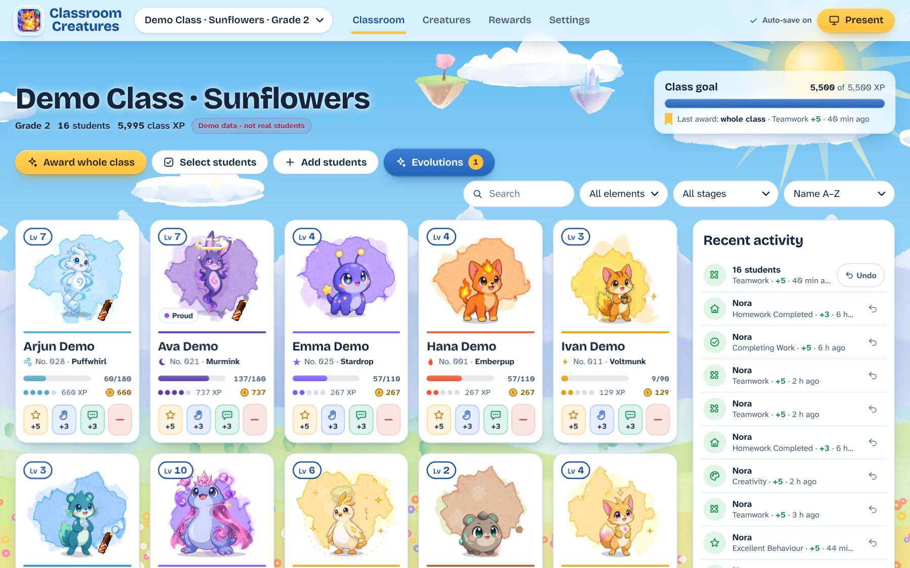</p>

| Creature profile | Dressing room | Evolution |
|---|---|---|
| 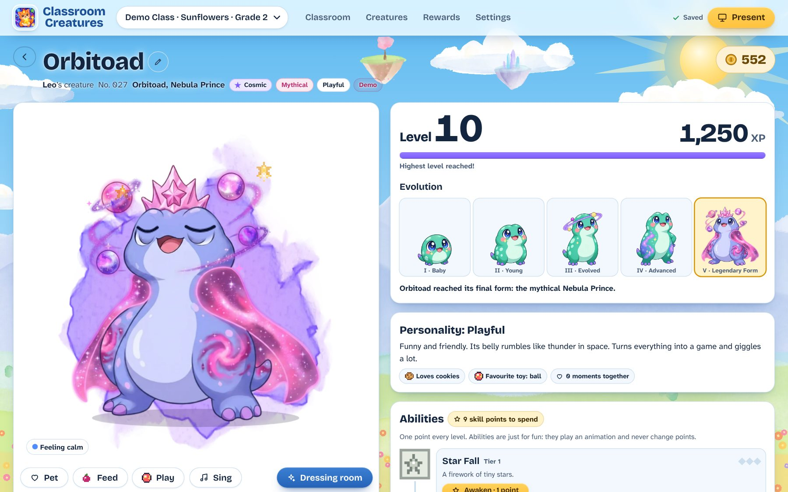 | 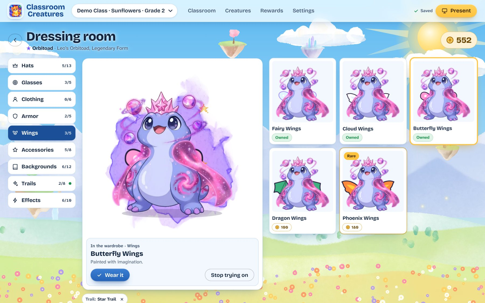 | 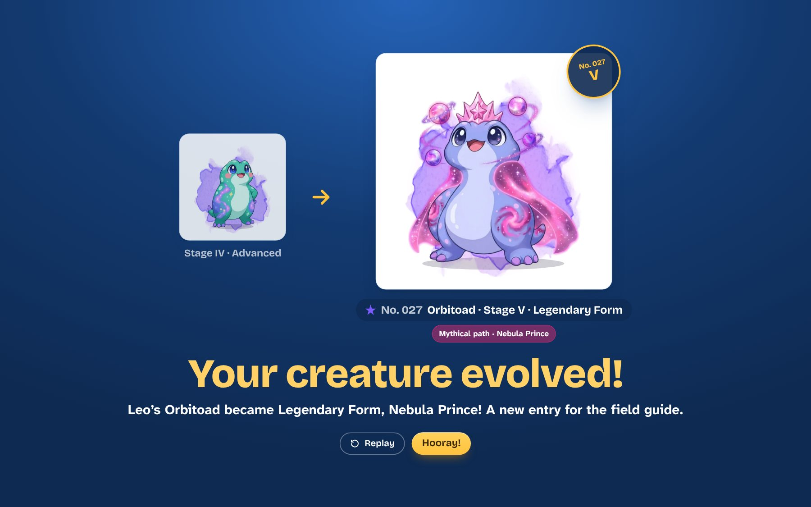 |

| Field guide | Teacher controls | Presentation mode |
|---|---|---|
| 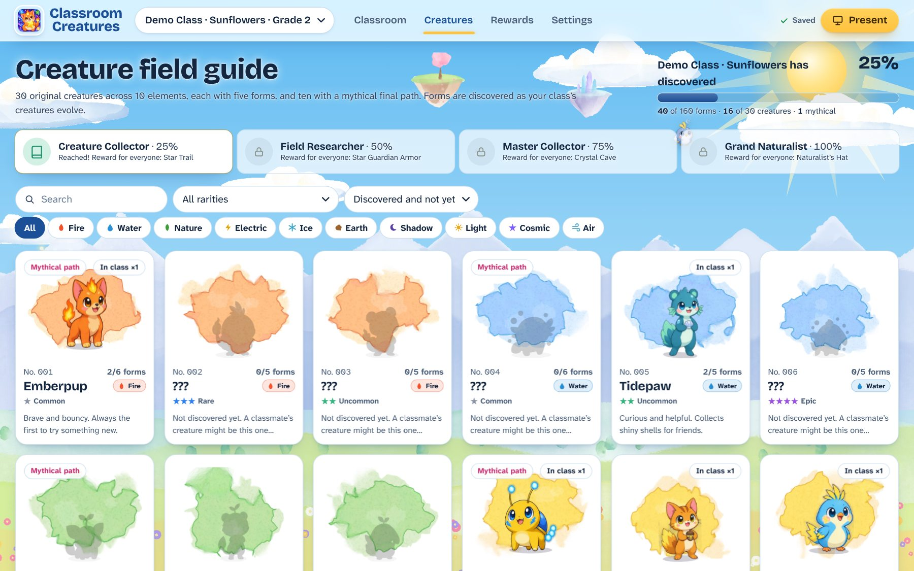 | 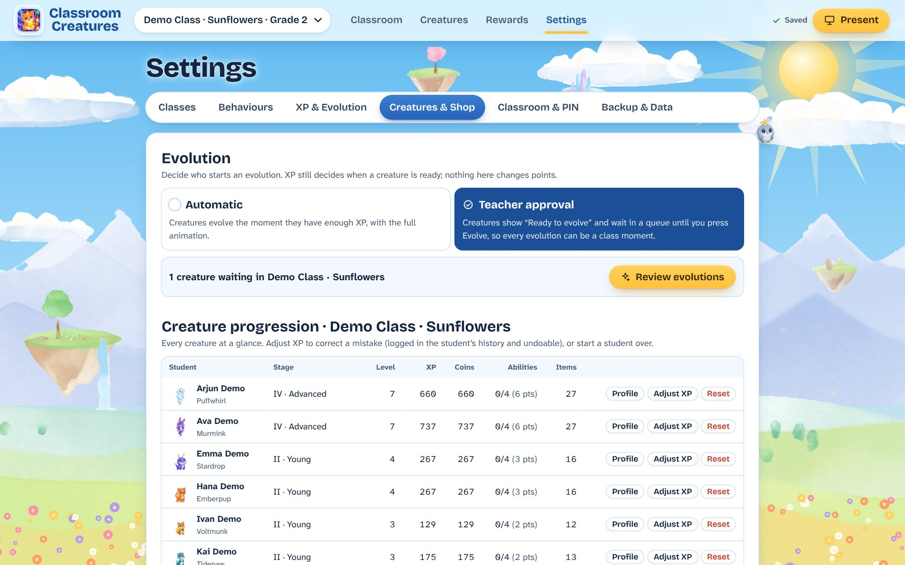 | 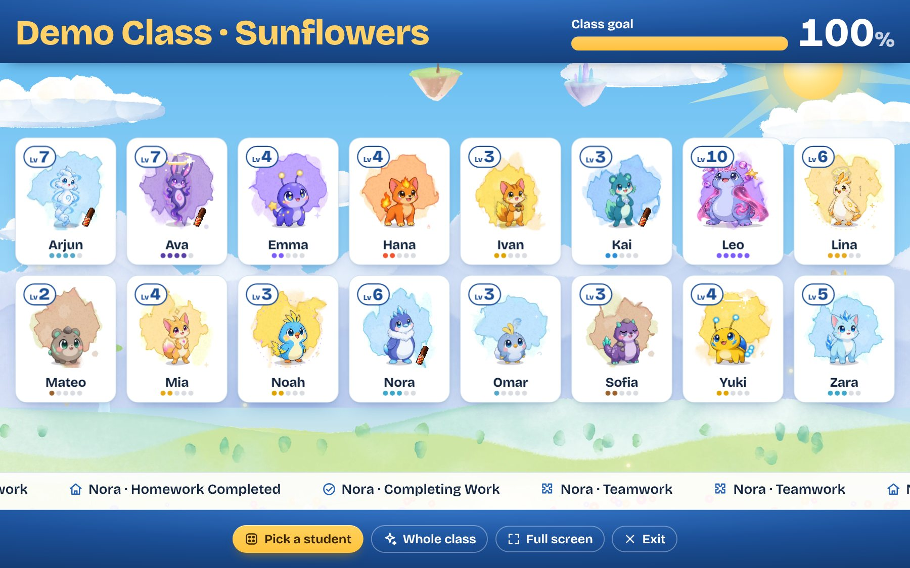 |

<p align="center">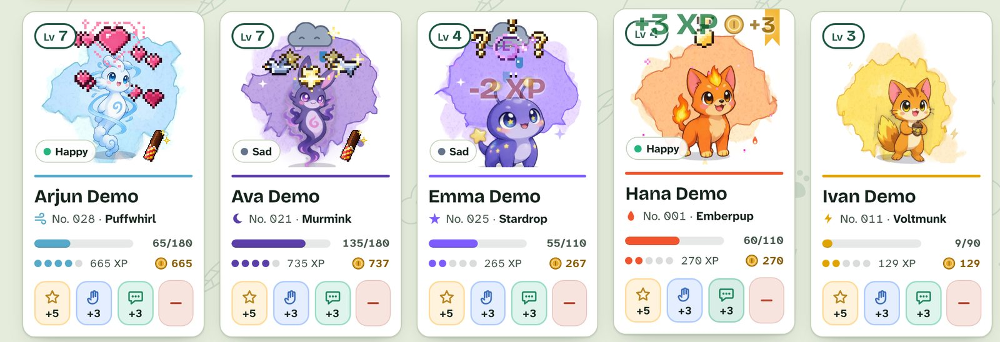</p>

## What's new in 1.8: the 3D stage

<p align="center">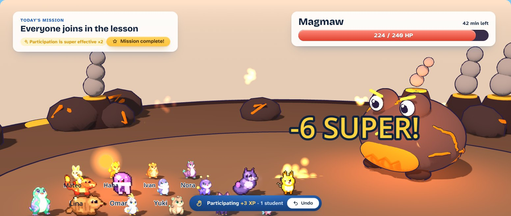</p>

The arena, the class world, three new class games and the evolution moment now play as **3D scenes made in [Godot](https://godotengine.org)**, with your creatures in them, outfits included. The app still runs every rule, point and reward; the 3D stage only draws.

- **3D boss arena.** A Blender-built set for each of the nine regions. A creature's attack makes it hop, the boss **turns toward it**, its element flies and bursts with **real lighting and particles**, and the **camera shakes** (and zooms in on a super-effective hit). A strike back leaves a creature dazed with stars. Befriend the boss and the camera comes in **close** while everyone celebrates. Tap a creature to give points.
- **A class world you can walk around.** The five places on one island at the stages your class has built (each pops up when it grows), every creature wandering the paths and greeting the others, befriended bosses strolling round in all eight directions (sprites made with SpriteCast), the decorations you earned. Drag, zoom, tap a creature to see whose it is.
- **Class games** in the new **Games** tab: a **class relay** powered by today's points (the class races a boss as one team), **catch the stars** and a **memory match** with your field guide's creatures. Nobody is ranked and no points change.
- **Creatures come alive in 3D** with no new art: breathing, swaying, hops, lunges, flinches and a happy wobble, their **element on their own body** (fire shimmers, water ripples, electric crackles, a mythical aura), lit by the scene and casting shadows.
- **A bigger evolution**: the creature turns to light, its element swirls, a flash, and it dissolves into its next form.
- **Settings → Classroom → 3D scenes** switches back to the 2D versions; computers that cannot run 3D get them automatically.

| The class world | Class relay | Evolution |
|---|---|---|
| 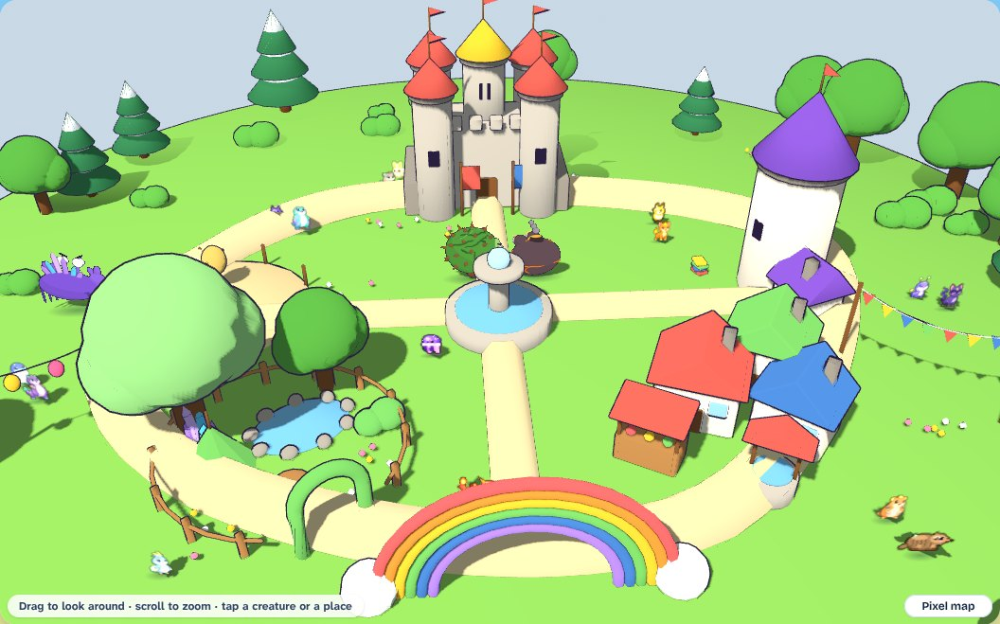 | 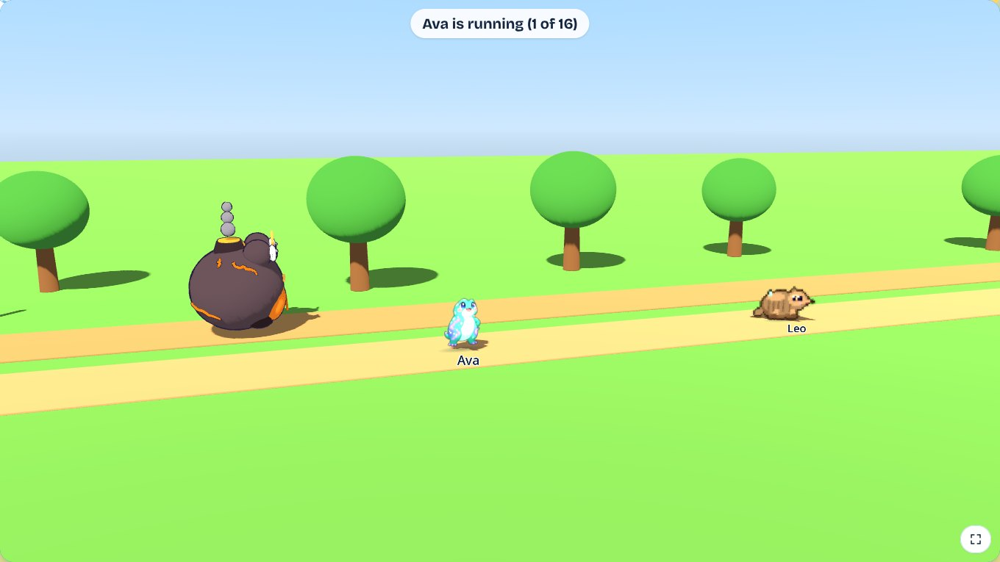 | 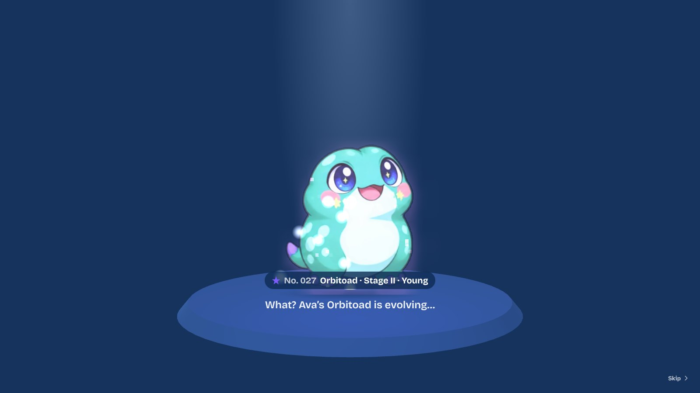 |

How the stage is made: [The 3D stage](#the-3d-stage). Release notes: [docs/release-notes-1.8.0.md](docs/release-notes-1.8.0.md).

## What's new in 1.7: the bosses come alive

<p align="center">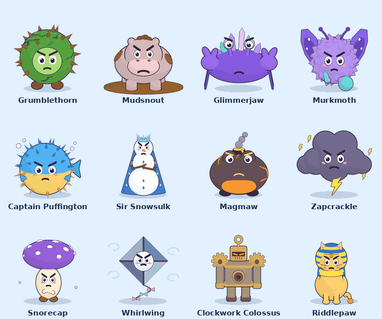</p>

The twelve bosses are now **animated 3D characters**. Each one was built as a 3D model in Blender, after its painting, and rendered into animation frames with [SpriteCast](https://github.com/dark3panther/spritecast).

- **In the arena** a boss breathes and blinks while it waits, **flinches every time a creature hits it**, winds up and **lunges when it strikes back**, and **hops for joy** once befriended, in its befriended look (Grumblethorn bursts into flowers, Captain Puffington puts on his hat, Zapcrackle turns into a white cloud with a rainbow).
- **Wandering bosses walk** to and fro along a lane on their region's page.
- **Treasure chests burst open**: the chest-opening moment is a 3D chest made in Blender, in its own colours. The lid flies up, light pours out and sparkles burst.
- In **Pixel mode** the bosses are pixel art drawn from the same animation, so they move too.
- **Settings → Adventure → Animated bosses** turns them back into the still paintings. Reduce motion shows one still picture per mood.

| In the arena | The chest opens |
|---|---|
| 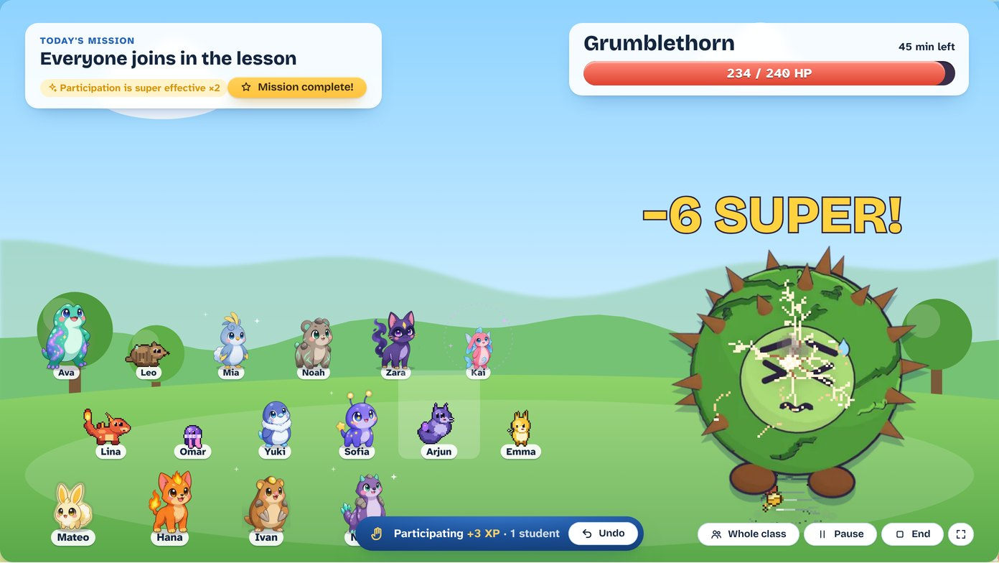 | 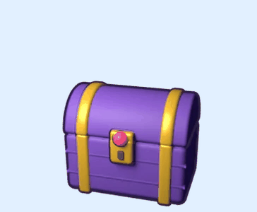 |

How the bosses and the chest are made: [Boss models and sprites](#boss-models-and-sprites). Release notes: [docs/release-notes-1.7.0.md](docs/release-notes-1.7.0.md).

## What's new in 1.6: lesson battles

> **1.6.1** fixes creatures disappearing in Pixel mode on some Macs, and renames the Crystal Caverns' wandering boss to Murkmoth ([release notes](docs/release-notes-1.6.1.md)).


<p align="center">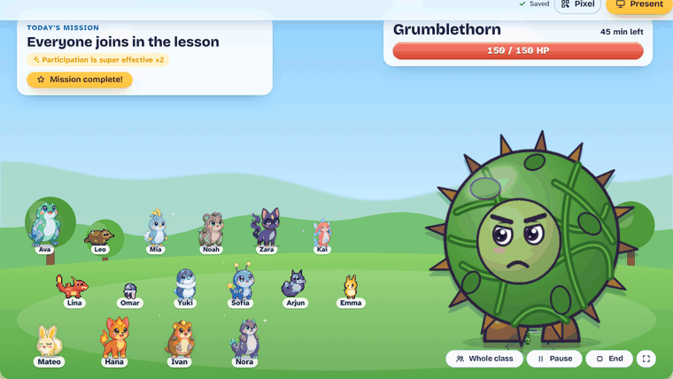</p>

A boss battle that fits one or two lessons, played on the projector. **Every point you give is a creature's attack, and every point you take makes the boss strike back.**

- **Start it in about ten seconds.** Adventure → Boss Battle → *Start battle* on a boss → *Lesson battle*. Pick today's **class mission** (nine ready-made ones, like "Everyone joins in the lesson" or "Finish today's work", or write your own), what is **super effective** today, one or two lessons, and how tough the boss is. The boss's HP is worked out from your class size and your award values.
- **Points are attacks.** Give points as usual, in the arena (tap a creature), on the classroom page or anywhere else. That creature hops and its element flies at the boss: fireballs, water orbs, ice lances, ball lightning, earth orbs, shadow orbs, tornadoes. The boss flinches and its HP goes down. Points for today's super-effective behaviour count **double**, and an award to the whole class is a **team attack**.
- **Losing points: the boss strikes back.** Take points from Ahmed and the boss strikes back at Ahmed's creature, in its own silly way (Grumblethorn tangles it in brambles, Mudsnout splatters mud, Sir Snowsulk throws a snowball). The creature is dazed for a few seconds and the boss gets the lost points back, at most a fifth of its HP in a whole battle. Ahmed loses only the points you took. Nobody is ever knocked out. You can switch strikes off for a battle.
- **Finish the mission together for the team finisher.** Press *Mission complete* and every creature attacks at once, for a quarter of the boss's HP. A typical lesson of awards plus the mission befriends the boss.
- **Two lessons? It waits.** When the time is up the battle pauses with its HP kept. Press *Start the next lesson* next time.
- **Befriended.** The boss bursts into a happy face in the arena, and everyone gets a small reward (2 XP and 5 coins by default).
- Made for the projector: big names, a big HP bar and banners, and a full-screen button. In Pixel mode the arena, the boss and the effects are all pixel art.

| A creature attacks | The boss strikes back | Pixel mode |
|---|---|---|
| 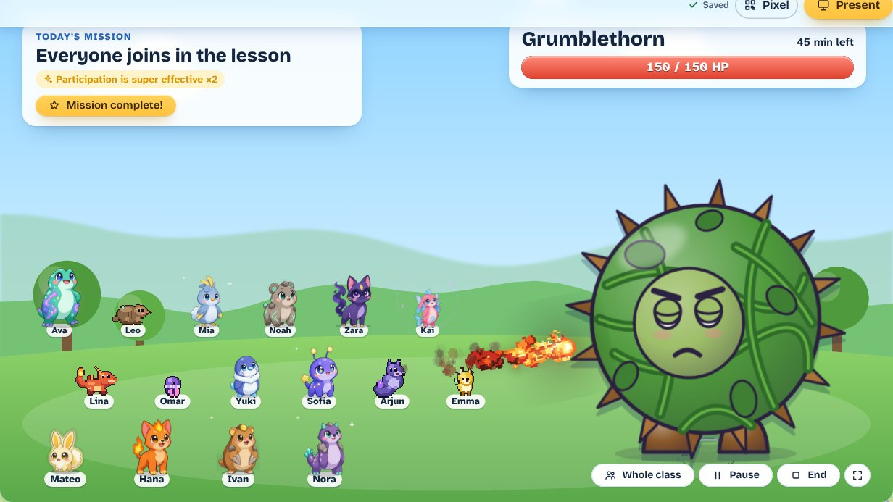 | 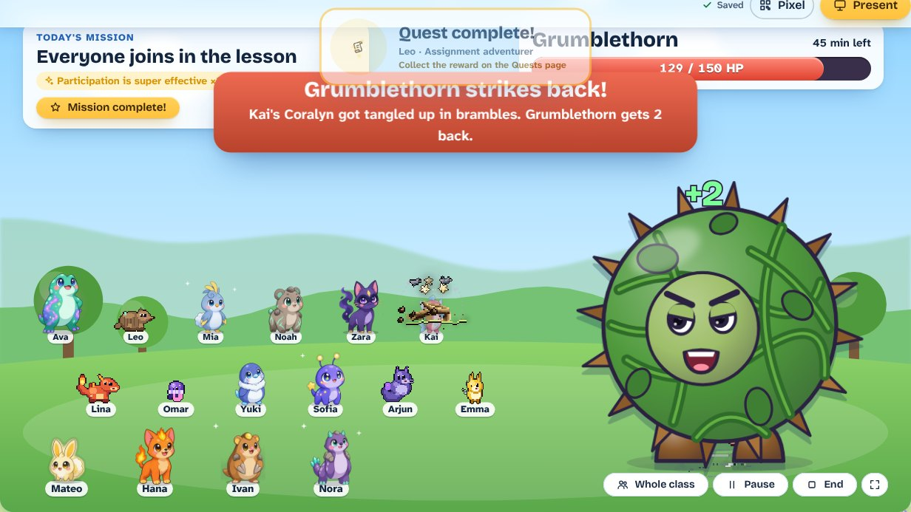 | 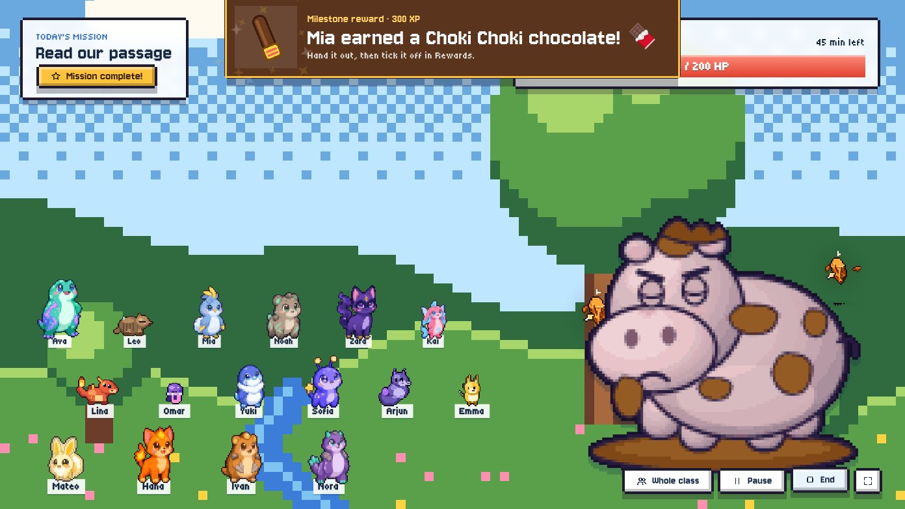 |

**More world, more bosses.** Three new regions: **Coral Lagoon**, **Mushroom Hollow** and **Sunstone Desert**, each with a relic, chests, a background and a boss gift. Six new bosses: **Captain Puffington**, **Snorecap** and **Riddlepaw** guard the new regions, and **Mudsnout**, **Murkmoth** and **Zapcrackle** wander older ones, so a class has two bosses to battle from day one. Every boss is now a **painted** illustration with four faces (grumpy, hurt, attacking, befriended), blinking eyes, an aura from its element and its own strike. The 1.5 boss gifts (Bramble Crown, Crystal, Lava and Cloud trails, Star Temple Crown, Snow Goggles) now actually show on the creature.

<p align="center">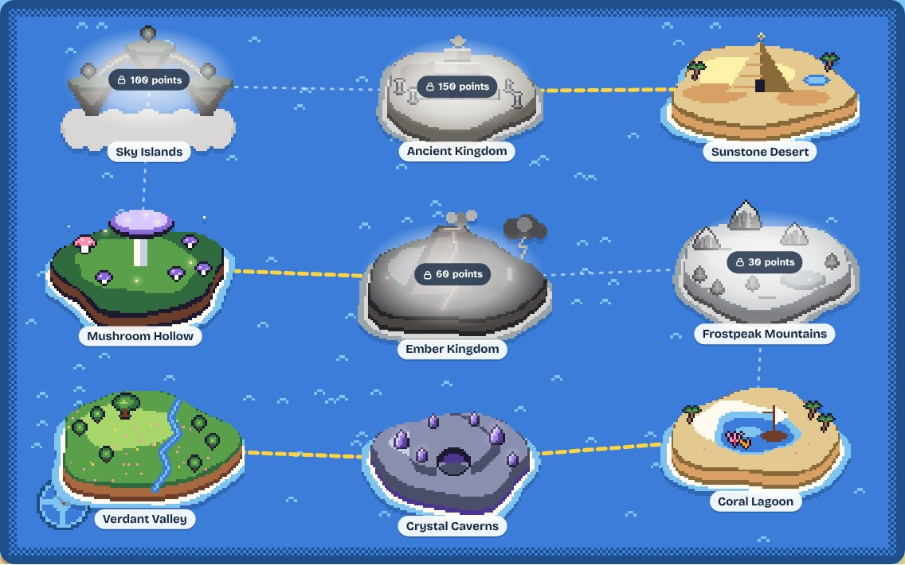</p>

The rules, numbers and reasons are in [docs/adventure-design.md](docs/adventure-design.md) (section 3.6).

## What's new in 1.5.2: the Pixel Pals

<p align="center">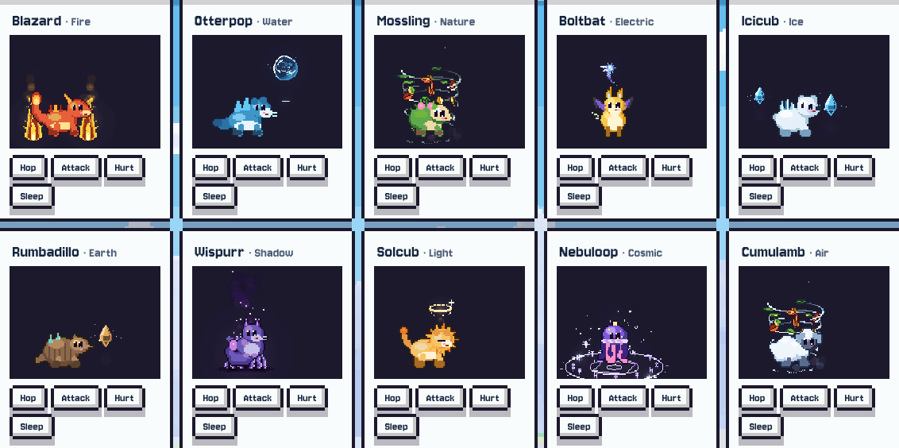</p>

- **Ten new creatures, drawn as pixel art from the start**, one for each element: Blazard (fire), Otterpop (water), Mossling (nature), Boltbat (electric), Icicub (ice), Rumbadillo (earth), Wispurr (shadow), Solcub (light), Nebuloop (cosmic) and Cumulamb (air). Each has five forms that grow and change like every other creature, so the class has 40 creatures and 210 forms to find in the field guide. New students can be given a Pixel Pal; nobody's existing creature changes.
- **Animated frame by frame, like a real pixel game.** Every form has six hand-timed animations: breathing while it stands (tail, ears and wings moving too), blinking, a happy hop, an attack (wind up, lunge, recoil), flinching when it loses points, and sleeping with its eyes shut. The app picks the animation from what is happening, and each creature keeps its own rhythm so a class never moves in step.
- **Their element attacks come out of the right place.** Breath attacks start at the pal's mouth and the auras sit around its own body, frame by frame.
- **They dress up.** Hats and glasses follow the head through every frame of every animation (a hat bobs, hops and lunges with it). Clothes and armour sit on the body, and wings and capes rise from the back, behind the pal.
- **Pixel Pals are pixel art in both looks.** In the painted look they stand among the painted creatures as pixel sprites; in Pixel mode they fit right in.
- **The painted creatures breathe in Pixel mode too.** Their pixel sprites now breathe the way hand-animated sprites do (the upper body rises a pixel, the chest grows a row) and blink at random moments.

## What's new in 1.5.1: Pixel mode

<p align="center">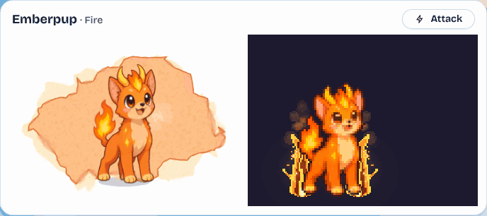</p>

- **One switch turns the whole app into pixel art.** Press **Pixel** in the top bar (or Settings → Classroom & PIN → *Pixel mode*). The creatures become pixel sprites, and the buttons, panels, progress bars, text, creature backgrounds and the sky all turn pixel too. Press **Painted** to switch back. Nothing else changes: same classes, points, coins and items.
- **Every creature as a real pixel sprite**, made from its own painting and everything it is wearing (hats, glasses, wings and the rest). Each sprite has a hand-drawn style outline, bobs a whole pixel at a time and blinks every few seconds, each creature on its own rhythm.
- **Element effects from the pixelfx library.** On the big views (profile, Presentation spotlight, student pop-up, dressing room) each element has a pixel aura: dancing flames for fire, a floating water orb, swirling leaves, a ball of lightning, ice crystals, a glowing gem for earth, shadow flames, a halo for light, a rune circle for cosmic creatures and a whirl of wind for air. When a creature uses its ability it **attacks**: it leans back, lunges and lets go of fire breath, a water jet, whipping vines, chain lightning, frost breath, earth spikes, shadow tendrils, a beam of light from the sky, falling stars or a tornado.
- **Readable for young students.** The pixel fonts (Jersey 10 for headings, Tiny5 for text) were picked because their numbers are clear, and they are sized to match the painted look.
- **See them all at once** on the preview page (`#/pixel-lab`): each element's creature painted and as pixel art, attacking every few seconds.

<p align="center">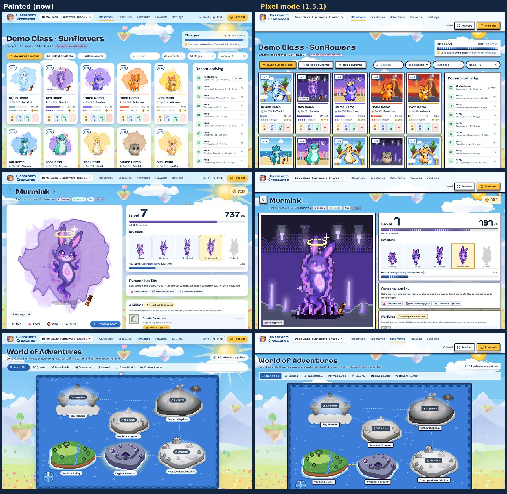</p>

<details><summary>All ten element attacks</summary>
<p align="center">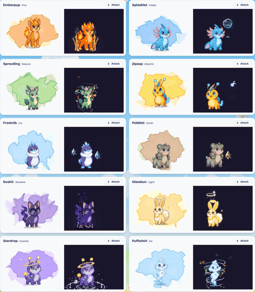</p>
</details>

## What's new in 1.5: the World of Adventures

<p align="center">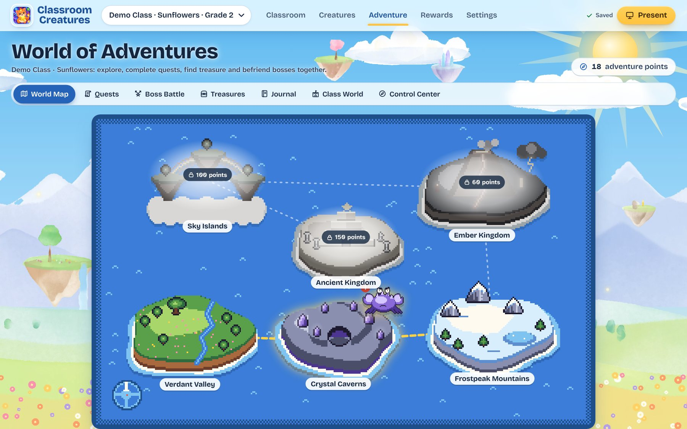</p>

| Quests | Boss battle | Class world |
|---|---|---|
| 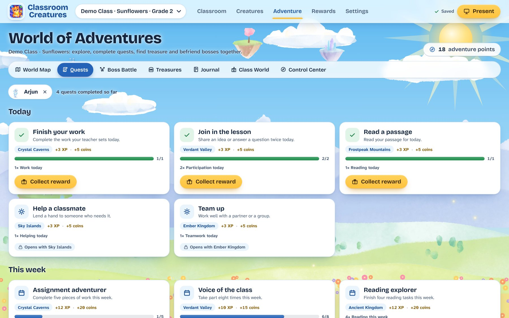 | 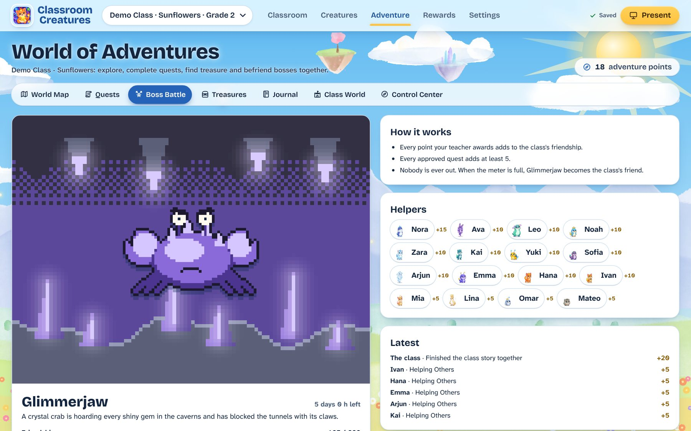 | 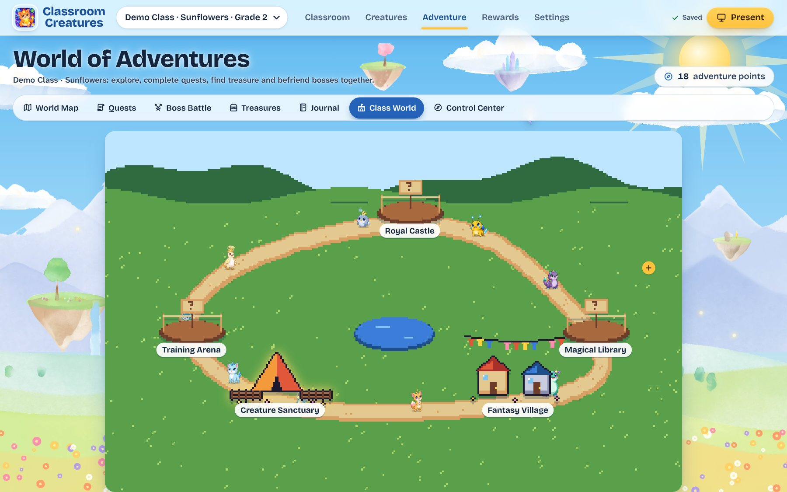 |

| Region | Treasure | Adventure Control Center |
|---|---|---|
| 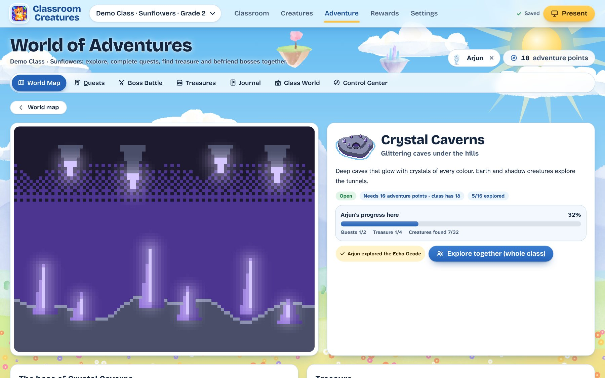 | 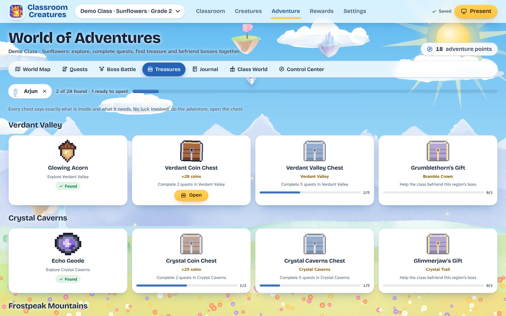 | 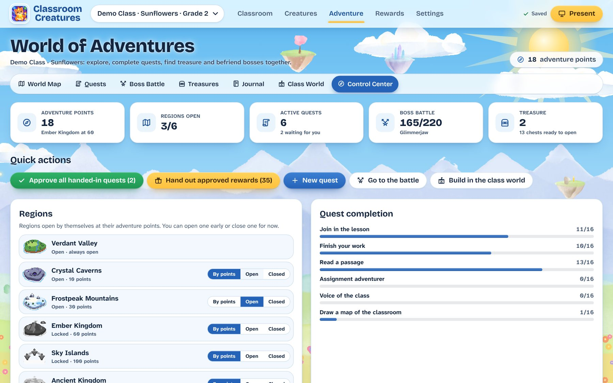 |

- **A world map to explore.** Six regions: Verdant Valley, Crystal Caverns, Frostpeak Mountains, Ember Kingdom, Sky Islands and the Ancient Kingdom. Each has its own pixel-art island and place, a description, quests, four treasures, the creatures that live there, a boss and a completion percentage for every student. Regions open for the whole class as it earns **adventure points** (the class average of the XP students earn and the quests they complete, plus 20 for every boss befriended), or whenever the teacher opens one.
- **Quests.** Daily, weekly and special quests with a title, description, category, region, XP and coin reward and an optional shop item. Assign one to the whole class or to chosen students, give it start and end dates, and choose whether it counts by itself from the points you give or whether students hand it in. Create, edit, duplicate and delete quests (their history is kept), approve hand-ins, or send them back with a short note so the student can try again. Your old challenges came along as quests.
- **Students can never reward themselves.** A student's hand-in always waits for the teacher, and every reward is written into a ledger and given exactly once, however often Collect is pressed. The engine refuses teacher actions from a student; it does not only hide the buttons.
- **Boss battles the whole class wins together.** Six original bosses (a bramble beast, a crystal crab, a sulky snow giant, a lava toad with hiccups, a storm kite and a clockwork guardian). Pick one, how many points the class needs, how long and the reward. Every point you award, every approved quest and any class activity you add fills the friendship meter. Nobody is ever out; when the meter is full the boss becomes the class's friend, every student gets the reward once and a statue joins the class world. If time runs out the boss just goes home to rest. Pause, resume or end it at any time; undoing an award takes its points back.
- **Treasure with no luck involved.** Coin chests, background chests, a boss gift per region, six relics to collect and four special treasures. Every chest shows exactly what is inside and what it needs. If a student already owns the item, the chest pays its coin value instead. New items: six region backgrounds, a World Map background, the Bramble Crown, Snow Goggles, Star Temple Crown and Crystal, Lava and Cloud trails.
- **An adventure journal** for every student: quests, explorations, treasure, the class's bosses and regions, badges and evolutions, by day, with filters.
- **A class world to build.** The Creature Sanctuary, Fantasy Village, Magical Library, Training Arena and Royal Castle each grow through three stages as the class earns adventure points. Decorations arrive with class quest milestones, befriended bosses leave statues, and the class's creatures stroll around the path. It can be switched off in Settings.
- **The Adventure Control Center** for the teacher: adventure points, regions, quests waiting, the boss battle and treasure at a glance; approve everything, hand out rewards, open or close regions, see who is helping the boss and the full adventure history.
- **Students join in from Presentation Mode** while teacher controls are locked: they tap their creature, see their quests, hand them in, collect approved rewards, open their chests and read their journal. Switch this off in Settings → Adventure.
- **Your data comes with you.** 1.4 data upgrades automatically (a safety snapshot is saved first). Students keep everything; challenges become quests (the original list is kept untouched) and challenges already completed today are not paid again.
- The pixel art is drawn in code with [claude-pxl](https://github.com/dark3panther/claude-pxl) (`scripts/pixel/*.px.js`, `npm run art:adventure`), and the rules are written up in [docs/adventure-design.md](docs/adventure-design.md).

## Also in 1.5: the sky world

- **A living painted sky behind every screen.** The green look is gone. The app now sits in a bright daytime world painted in watercolour: a blue sky warming to gold at the horizon, the sun with slowly turning rays, clouds drifting across, far mountains, floating islands that bob gently, rolling hills and a flower meadow. Now and then one of the class's winged creatures flies past, pollen floats up through the light, and the whole scene shifts a little as you move the mouse, near layers more than far ones.
- **Everything responds.** Buttons squash when pressed and spring back, lift under the mouse, and the main buttons throw a few sparks. Student cards lean towards the pointer. When a student gets points, their card bounces and "+5 XP" springs out of it, and XP and coin numbers roll to their new values. Pages build up section by section when they open, the creature cards ripple in, pop-up windows spring up and sink away, progress bars spring to their new length, and the tab underline and tab pills slide from tab to tab. Re-sorting the class makes the cards glide to their new places.
- **Clear on a projector.** Cards stay solid white, the header is frosted glass, headings on the sky carry a soft white halo, and Present uses a deep daytime blue with a gold class-goal bar. Buying keeps its green button.
- **For slower computers:** Settings → Classroom & PIN → *Animated background* turns the sky into a still painting, and *Reduce motion* calms every animation at once.
- **Mac app for Apple Silicon.** One download, for Macs with Apple chips (M1 and newer), built on a current Electron for macOS 26 and 27.
- The painting is made in code: `scripts/sky/paint.mjs` paints every layer with the p5.brush watercolour library, and the motion uses the anime.js animation library. Both are open source (MIT) and come from forks in this account.

## What's new in 1.4: the creature RPG update

- **Evolution can be a class moment.** Choose **Automatic** (creatures evolve as soon as they have the XP) or **Teacher approval** in Settings → Creatures & Shop. With approval on, a ready creature shows **Ready to evolve** and joins the **Evolutions** queue on the Classroom tab until you press **Evolve**. The evolution itself is a full-screen sequence: the creature turns to light under a pixel pillar, a flash, then the new form beside the old one, with its own sounds. Every evolution is kept in the creature's history, and evolving never changes XP or coins.
- **Two final paths.** Ten creatures choose at stage V between their classic Legendary form and a **Mythical** form with its own colours, ornaments and drifting pixel particles. The field guide counts both.
- **A dressing room for every creature.** 73 items in nine slots: hats, glasses, clothing, armor, wings, accessories, backgrounds, trails and effects. Students try anything on before buying, see what they own, what they are wearing, what is locked and what it costs, and buy with their own coins. There are rare items and seasonal ones (a Blossom Crown in spring, Summer Shades, an Autumn Leaf Crown, a Snowflake Scarf in winter) marked with how long they stay. Nothing is random: no loot boxes, nothing bought twice, and coins never go below zero. Undoing an award never takes back something a student bought.
- **A creature profile.** One page per creature: the creature itself to pet, feed and play with (snacks and toys are free and just for fun), level and XP, the evolution line with progress to the next form, its personality (seven kinds, each with a favourite snack and toy), abilities, achievements and the forms it has revealed. Open it from a student's pop-up, the Presentation spotlight or the progression table.
- **Abilities.** Every creature has four: two from its element, a signature move, and an ultimate that depends on its final path. Each has three ranks, and a creature earns one skill point per level. Abilities only play an animation; they never change points or give anyone an advantage.
- **The class field guide.** All 160 forms (30 creatures × 5 stages, plus the 10 mythical forms). Forms the class has not met yet are silhouettes. Search by name and filter by element, rarity or discovery. When the class discovers 25%, 50%, 75% and 100% of the guide, everyone gets a reward (Star Trail, Star Guardian Armor, Crystal Cave background, Naturalist's Hat).
- **Creature achievements**, each with its requirement and, where it has one, a reward: First Evolution, Evolution Master, First Legendary, Mythical Path, Customization Expert, Wardrobe Collector, Ability Adept, Ability Master, Best Friends, Creature Collector, Field Researcher, Master Collector and Grand Naturalist.
- **Teacher controls** in Settings → Creatures & Shop: the evolution mode and queue, a progression table for the class, **Adjust XP** to fix a mistake (logged in the student's history, undoable, never touches coins), **Reset progress** for one student (you type their name to confirm, and a safety snapshot is saved first), which creatures new students can get, and which items are offered and at what price.
- **Students can use their own creature while you stay locked.** From Presentation Mode, students can open their creature's profile and dressing room while teacher controls are locked. They can play, awaken abilities and spend their own coins, but they can never change XP or coins. Switch this off in Settings → Creatures & Shop.
- **Sound settings.** A volume slider, optional button clicks, and new sounds for evolving, buying, dressing up, abilities, snacks and toys. Everything still follows the **Sound effects** switch.
- **The paintings come alive.** Every painted creature blinks, each on its own rhythm with the odd double blink, so a class never blinks in unison; sleepy creatures doze with their eyes shut, and big views add a slow breath under each species' idle movement. Blinking and breathing stop with *Reduce motion*.
- **Starts faster.** Screens and pixel effects now load the first time they are needed.
- **Your data comes with you.** 1.3 data upgrades automatically when you open 1.4 (a safety snapshot is saved first). Students keep their creature, XP, coins, stage, items and history, and existing classes stay on Automatic evolution.

## What's new in 1.3

- **A new look: the creature field guide.** The dark purple night sky is gone. The app is now a naturalist's field guide for your class, built for a projector in a bright classroom: a light endpaper background printed with faint tracks and leaves, a bookcloth-green header, and dark ink text that stays readable from the back of the room.
- **Every creature has its own painted plate.** Each species sits on a watercolour wash in its element's colour and carries a field number (No. 001 to No. 030) that is the same on student cards, in the Creature field guide and in profiles.
- **See who was just rewarded.** Cards in the latest award keep a marigold ribbon until you give the next one. Marigold is used only for what is happening now: selected students, the current tab, the main action.
- **Bigger numbers where the class looks.** Presentation Mode shows the class goal as a large percentage, and profiles show level and XP at a size you can read across the room.
- New fonts (Bricolage Grotesque for headings, Atkinson Hyperlegible Next for everything else, both bundled for offline use) and a drawn icon set for every button.

## What's new in 1.2

- **Pixel art effects** from the [pixelfx](https://github.com/dark3panther/pixelfx) library (MIT, vendored in `src/vendor/pixelfx`), played live on top of every creature:
  - *Positive:* a sparkle burst and a "!" emote on every award, a **LEVEL UP!** banner, a power star for badges, a sunburst when a milestone treat is earned.
  - *Negative:* a pixel **BONK!**, then a status effect that matches the behaviour: dizzy stars and birds (talking without permission, moving around), a slow-down clock (task not finished), question marks (not listening).
  - *Emotes for moods:* pixel hearts (happy), a sparkling light beam (excited), a halo (proud), Zzz (sleepy), plus the rain cloud (sad).
- **A pixel chocolate stick.** When a student earns a Choki Choki milestone, their creature appears holding a pixel chocolate stick (an original drawing in a red and yellow striped wrapper, no brand logo) until you tick **Given ✓** in Rewards. Several waiting treats show a ×2, ×3 badge.
- **Earned accessories are worn automatically** in any empty slot, so creatures show off new hats, glasses, wings and decorations straight away.

## What's new in 1.1

- **New app icon** (made with Higgsfield).
- **Coins and a shop.** Students earn 1 coin for every positive XP point (adjustable). In a student's profile, **Shop** sells outfits (T-shirt, hoodie, overalls, party dress, super suit, raincoat), hats, heart glasses, a bow tie, a necklace, dragon wings, a bubble aura and new backgrounds. Bought items are worn from **Wardrobe**.
- **Milestone rewards.** Every 100 XP a student earns a **Choki Choki chocolate** (change the treat, the amount or add more milestones in Settings → Classroom & PIN). A popup tells you who earned one, and **Rewards → Milestone rewards to hand out** keeps the list until you tick **Given ✓**.
- **Behaviour deductions.** Talking Without Permission (−2), Moving Around (−2), Task Not Finished (−3), Not Listening to Instructions (−2), from the grey **−** button on each card or the award list. The creature gets a cartoon **BONK!**, dizzy stars and a sad rain cloud for a while. Deductions take XP only, never coins, never go below 0 XP and never undo an evolution.
- **Creature emotions.** Each creature feels **happy** after points, **excited** after several in a row, **proud** after a milestone, **sad** after a deduction, **sleepy** when ignored for a few days, and **calm** otherwise. Moods show on cards, profiles and in Presentation Mode (hearts, sparkles, rain cloud, Zzz, crown).
- **Class goal prize wheel** ([screenshot](docs/screenshots/prize-wheel.jpg)). When the class reaches its XP goal, everyone spins the wheel: funny video, gaming class, movie class, Choki Choki for everyone, extra playtime or a music & dance party (editable). The next goal is set automatically.
- **Livelier creatures.** Element particles drift around every creature (embers, bubbles, leaves, sparks…). In the profile and Presentation spotlight, creatures lean towards your pointer, react when tapped, and **press and hold to pet** them for hearts.
- Data from 1.0 upgrades automatically: students start with coins equal to the XP they already have, and past milestones count as already handed out.

## Quick start

Requires [Node.js](https://nodejs.org/) 18 or newer.

```bash
npm install
npm run dev
```

Open the address it prints (usually http://localhost:5173). On first launch a clearly labelled **demo class** is loaded so you can try everything; the welcome screen offers to set up your real class and a teacher PIN.

### Using it every day without the dev server

```bash
npm run build
npm run preview
```

`npm run build` writes a static site to `dist/`. It uses relative paths, so `dist/` can be served by any static web server (for example `npx serve dist`) or copied to a school intranet. Data is stored per browser *and* per address, so always open the app from the same address on the same computer.

### Mac app

Classroom Creatures also runs as a normal Mac app (a dock icon, its own window, native full screen for the projector, menu shortcuts ⌘1–⌘3 for the tabs, ⌘, for Settings and ⌘P for Presentation Mode). It works fully offline.

The app is built for Macs with Apple chips (M1 and newer).

**Easiest: build it on your Mac** (needs Node.js 18+):

```bash
npm install
npm run app:mac
```

This creates `release/Classroom Creatures-<version>-mac-arm64.dmg`. Open the `.dmg` and drag **Classroom Creatures** into **Applications**.

**Or download it:** grab the latest `.dmg` from this repository's **Releases** page. Every push to `main` also builds it (the *macOS app* workflow on the **Actions** tab, artifact `Classroom-Creatures-mac`), and a Release is published either by pushing a tag such as `v1.4.0` or from **Actions → Release → Run workflow** with the version number (the tag is created for you).

**First launch of a downloaded copy:** the app is signed "ad hoc" but not notarised by Apple (that needs a paid Apple Developer account), so macOS asks once. Open it; if macOS says it cannot check the app, go to System Settings → Privacy & Security, scroll down and click **Open Anyway** (on older macOS, right-click the app → **Open** → **Open** also works). If macOS ever says the app "is damaged", run these once in Terminal, then open it normally:

```bash
xattr -cr "/Applications/Classroom Creatures.app"
```

```bash
codesign --force --deep --sign - "/Applications/Classroom Creatures.app"
```

**Your data in the Mac app** is stored in `~/Library/Application Support/Classroom Creatures`, separately from any browser copy. To move a class from the browser version into the app, use Settings → Backup & Data → *Download backup file* in the browser, then *Restore from file* in the app.

**No Mac to build on?** `npm run app:mac-zip` also works on Linux and Windows and makes `Classroom Creatures-<version>-mac-arm64.zip`. Install [rcodesign](https://github.com/indygreg/apple-platform-rs) first (`cargo install apple-codesign`) so the build signs the app ad hoc, as `codesign` does on a Mac; without a sealed signature macOS reports a downloaded app as "damaged". The build prints a warning if rcodesign is missing. Intel builds are no longer made: Intel apps on Apple Silicon need Rosetta, which macOS is retiring.

To try the desktop shell without packaging: `npm run app`. The same config also builds Windows (`npx electron-builder --win`) and Linux (`npx electron-builder --linux`) versions.

### Other commands

| Command | What it does |
|---|---|
| `npm run dev` | Development server with hot reload |
| `npm test` | Unit tests for the XP, evolution, shop, ability, achievement, quest, boss, lesson battle, treasure, region, journal, import, backup and storage code (Vitest) |
| `npm run test:e2e` | End-to-end check in a real browser: the 1.3 to 1.4 upgrade, playing with a creature, abilities, buying an item, a teacher-approved evolution, the field guide, locked student mode, persistence after a restart, and phone width. Needs Playwright (`npm i -D playwright && npx playwright install chromium`); `E2E_SHOTS=out` also saves screenshots |
| `npm run test:e2e:adventure` | End-to-end check of the World of Adventures: the 1.4 to 1.5 upgrade, creating a quest, a student handing it in from the locked kiosk, approval, collecting a reward exactly once, a boss battle, exploring and opening a chest, the journal, the Control Center, a restart, and phone width |
| `npm run test:e2e:pixel` | End-to-end check of Pixel mode: switching it on from the top bar, pixel sprites that breathe and blink, pixel type and backgrounds, element auras and attacks, a Pixel Pal's animation and hat on its profile, the Pixel Pals in the field guide, the setting surviving a restart, phone width, and switching back |
| `npm run test:e2e:battle` | End-to-end check of lesson battles: the nine regions and twelve painted bosses, starting a lesson battle, giving points from the arena (an attack, a super-effective award), a deduction (the boss strikes back, the creature is dazed and recovers), pause, the classroom's battle strip, the mission's team attack, befriending the boss, Pixel mode and phone width |
| `npm run art:adventure` | Rebuild the pixel art in `public/adventure/` (islands, region places, relics, chests, the class world) from `scripts/pixel/*.px.js` (needs Node 22.18 or newer) |
| `npm run art:creatures` | Rebuild the Pixel Pals' sprite sheets in `public/creatures-pixel/` and their animation data in `src/data/pixelPals.json` from `scripts/pixel/creatures.px.js` (needs Node 22.18 or newer and Python with Pillow) |
| `npm run typecheck` | TypeScript check |
| `npm run build` | Type-check and build the production site into `dist/` |

## Classroom workflow

1. **Classroom tab**: every student card shows the creature, level, XP bar, stage and three quick-award buttons (the behaviours you ⭐ pin in Settings).
2. **Click a card** to open the student pop-up: a big animated creature, the full award grid, what the creature is wearing, badges, challenge progress, history and management tools. **Creature profile** opens the creature's full page, with the **Dressing room** one tap away.
3. **Select students** to award several at once, or **Award whole class**.
4. Every award shows a floating **+XP**, a chime and a creature celebration. Level-ups, achievements and evolutions trigger their own celebrations automatically.
5. **Made a mistake?** Every award shows an **Undo** toast for 10 seconds, and any award can be undone later from the activity panel or the student's History tab. Undo also takes back badges or items that award unlocked.
6. **Evolutions** (with Teacher approval on) lists the creatures ready to evolve. Press **Evolve** for one, or **Evolve all**; a creature at its last stage with two paths asks which one to take.
7. **Present** opens a full-screen projector view: first names and creatures only (no XP totals, no rankings), a class-goal bar, an awards ticker, a spinning random student picker and a big spotlight view.
8. **Adventure** is where the class explores: the world map, quests (approve hand-ins, then students collect their rewards), the boss battle, treasure, journals and the class world. The **Control Center** has the quick actions. The points you give on the Classroom tab drive all of it: they fill quests, calm the boss and earn adventure points.

## Project architecture

```
src/
├── types.ts                 Domain types (AppData is everything that is persisted)
├── data/                    Pure content: species, elements, defaults, achievements, items, challenges,
│                            final paths (branches.ts), abilities and personalities; adventure.ts holds the
│                            regions, bosses, treasures, class-world places, starting quests and every tuning number
├── engine/                  Pure, unit-tested game logic (no React, no storage)
│   ├── progression.ts       XP → level → stage, next-evolution targets, readiness, table validation
│   ├── awards.ts            applyAward / undoBatch / unlock evaluation / challenge progress / purchases
│   ├── evolution.ts         Approval queue, one-stage evolutions, final-path choice, evolution history
│   ├── collection.ts        Forms revealed, class discoveries, field-guide statistics
│   ├── abilities.ts         Skill points, ability ranks and the ability tree view
│   ├── shop.ts              Item states (owned, wearing, buyable, locked, seasonal), prices, buying
│   ├── roster.ts            Unique creature assignment, student/class factories, CSV/name parsing
│   ├── backup.ts            Backup file format, validation, normalisation and step-wise data migrations
│   ├── demo.ts              Clearly labelled demo class
│   ├── pin.ts               Salted SHA-256 PIN hashing
│   └── adventure/           World of Adventures: permissions (Actor), quests (state machine), bosses,
│                            treasures, world (adventure points, regions, class world), journal, and the
│                            hooks that run after every award and undo
├── store/
│   ├── store.ts             Zustand store: actions call the engine, queue celebrations, auto-save
│   └── storage.ts           IndexedDB persistence, localStorage mirror, rolling snapshots
├── creatures/
│   ├── CreatureSvg.tsx      Parametric SVG renderer for all species × 5 stages
│   ├── accessories.tsx      Hats, glasses, wings, magic, decorations
│   ├── Creature.tsx         Animated wrapper: idle loop, reactions, particle bursts
│   ├── Burst.tsx            One-shot element/sparkle/confetti particles
│   ├── Habitat.tsx          Element habitats, unlockable backgrounds and painted pixel scenes
│   ├── PixelFx.tsx          Plays pixelfx effects on one shared animation clock, loading each on first use
│   ├── pixelSprite.ts       Pixel mode: turns a creature and its outfit into a pixel sprite (open and blink frames)
│   ├── PixelCreature.tsx    Pixel mode: the sprite on screen, bobbing a pixel at a time and blinking
│   └── pixelStage.ts        Pixel mode: each element's aura and attack (pixelfx effects and where they sit)
│   ├── pixel.tsx            Pixel sprites (snacks, toys, ability icons) and trail particles
│   ├── bosses/              BossArt (painted bosses in code), BossSprite (the animated 3D bosses, 1.7) and BossPortrait,
│   │                        which picks one (and walks the wandering bosses along their lane)
│   └── mythic.tsx           Colour grade and ornaments for the mythical final forms
├── (electron/main.cjs)     Desktop shell: serves dist/ from a private app:// origin, menus, full screen
├── audio/sfx.ts             All sounds synthesised with Web Audio (original, offline)
├── components/              Cards, award grid, celebrations, toasts, top bar, PIN lock, UI kit,
│                            SkyWorld (the animated painted background), CountUp (rolling numbers)
├── views/                   Dashboard, StudentProfile, CreatureProfile, Customize (dressing room), Creaturedex
│                            (field guide), Rewards, Settings, TeacherCreatures, Present, Onboarding;
│                            adventure/ holds the World Map, Region, Quests, Boss, Treasure, Journal, Class World
│                            and Control Center screens
├── lib/                     Hash router, view-model helpers, motion.ts (anime.js vocabulary: springs, pops,
│                            count-ups, staggered entrances, sliding tab pills) and interactions.ts (app-wide
│                            button presses, hover lifts, sparks and card tilt)
└── vendor/                  anime.js and pixelfx (both MIT, unmodified except where noted)
scripts/pixel/               The adventure pixel art as code (claude-pxl): islands, regions, bosses, chests, places, the pixel sun
scripts/sky/pixelate.py      Pixel mode copies of the painted sky layers (public/sky-pixel/)
scripts/bosses-3d/           The bosses as Blender models from code, rendered into sprites by SpriteCast (public/bosses3d/)
scripts/blender/chest.py     The 3D treasure chest, modelled, animated and rendered in Blender (public/chests/)
godot/                       The 3D stage (Godot 4.4): arena, class world, games, evolution, exported to public/godot/
public/adventure/            The built pixel art (68 small PNGs, about 280 KB)
```

**Data flow.** UI → store action → pure engine function returns a new `AppData` → store commits it (debounced save to IndexedDB) and pushes UI-only celebration events (evolution, level-up, achievement, class goal, quest, boss befriended, region opened) to a queue that `CelebrationHost` plays one at a time.

**One reward pipeline.** The adventure has no XP or coin system of its own: quest, boss and treasure rewards go through `applyReward` in `engine/awards.ts`, next to `applyAward`, so levels, evolutions, badges, milestone treats, the history and undo all work for them. Every reward has a ledger key (`quest:<record>`, `boss:<battle>:<student>`, `treasure:<id>:<student>`) that can be granted once.

**Ready for cloud sync later.** All persisted state is one serialisable `AppData` object with a `version` field, every record has a stable id, and awards are an append-only event log with batch ids. A sync backend can replicate `AppData` (or the event log) without changing the UI or the engine.

## Creature artwork

Every creature has illustrated artwork for all five stages (150 images in `public/creatures/`, about 4 MB). The art was generated with Higgsfield (GPT Image 2.5): one transparent image per species showing its whole five-stage evolution line, written from that species' design data and reviewed by hand so every design stays original and doesn't resemble an existing franchise character. The prompts are generated by the data in `src/data/species.ts`.

- `scripts/slice-lineup.py <lineup.png> <id>` cuts a lineup into `<id>-1.webp` … `<id>-5.webp` (needs Python with Pillow, NumPy and SciPy).
- `scripts/creature-anchors.py` measures where each creature's head and eyes are and writes `src/data/creatureArt.json`, which is how hats, glasses and other accessories line up on the illustrations.
- **Mythical forms**: Frostflame Warden, Stormtide Herald and Nebula Prince are painted, generated with Google Gemini (Nano Banana Pro) from each species' own Legendary art, so the creature, pose and style carry over. The other seven are still drawn from the Legendary art with a colour grade and ornaments (`src/creatures/mythic.tsx`). To add a painting, put `public/creatures/<id>-5b.webp` (512×512, transparent, same height and floor line as `<id>-5.webp`) in place and run `scripts/creature-anchors.py`; the app picks it up automatically. If the measurement misreads an image, correct it in `scripts/creature-anchor-overrides.json`.
- The original vector drawings are still in the app. Teachers can switch to them in **Settings → Classroom & PIN → Illustrated creature art**, and any species without an illustration automatically uses them. Open `?sheet` in development to see the vector set, or `?sheet&art` for the illustrations.

### The Pixel Pals

The ten Pixel Pals are drawn in code, not painted: `scripts/pixel/creatures.px.js` describes each one with [claude-pxl](https://github.com/dark3panther/claude-pxl) shapes (body, head, ears, tail, wings, face) and a shared pose function that moves those parts for every frame of the six animations. `npm run art:creatures` draws all 50 forms × 6 animations (outlined, 64×66 px a frame), packs each form into one sheet (`public/creatures-pixel/<id>-<stage>.png`, 8 columns, one row per animation) and measures where the eyes, mouth, head and body are in every frame (`src/data/pixelPals.json`). `src/creatures/PixelPal.tsx` plays the sheet on the app's shared animation clock and draws worn items on the head offset measured for that frame. `src/data/pixelPals.test.ts` checks the sheets and measurements.

To add a Pixel Pal: add a `draw(c, h, p, stage)` entry to `SPECIES` in `creatures.px.js` (copy the closest one), run `npm run art:creatures`, and add it to `PALS` in `src/data/species.ts` with `pixelArt: true`.

## Boss models and sprites

The animated bosses (1.7) are made in two steps, both free and offline once the tools are installed:

1. **Blender builds each boss from code.** `scripts/bosses-3d/` holds a small modelling kit (`kit.py`: rounded shapes, a dark outline baked into the geometry as an inverted hull, the rig and the clip writer), the face every boss shares (`common.py`: eyes, brows, closed eyes and mouths for the grumpy, hurt, attacking and happy moods, switched by bones) and one builder per boss (`bosses.py`), written after the painted art in `src/creatures/bosses/BossArt.tsx`. `build.py` runs headless and exports a rigged GLB per boss with five clips: idle, walk, attack, hurt and happy.
2. **SpriteCast renders the sprites.** Each GLB goes through SpriteCast's character pipeline with `"rig_glb"` and `"draw": false`, so its toon renders are the frames and no paid drawing step runs. `export_sprites.py` keeps the front-facing actions and the side walks, saves them as WebP strips in `public/bosses3d/<id>/` and writes `src/data/bossSprites.json`.

```bash
BLENDER=/path/to/blender SPRITECAST_PY=~/.cache/spritecast/venv/bin/python npm run art:bosses   # all twelve, ~30 min
python scripts/bosses-3d/peek.py out.png grumblethorn   # a quick front-only look while shaping a model
```

To change a boss, edit its builder in `bosses.py`, look at it with `peek.py`, then run `scripts/bosses-3d/render_all.sh <id>`. The models and renders land in `art/` (git-ignored); only the WebP strips and the manifest are committed. `src/creatures/bosses/BossSprite.tsx` plays them; `BossPortrait` uses them when animated bosses are on and falls back to the painting.

The **treasure chest** is `scripts/blender/chest.py` (modelled, animated and rendered with Blender's Cycles, 24 frames for each kind of chest) packed by `scripts/blender/pack_chests.py` into `public/chests/`: `npm run art:chests`.

## The 3D stage

The 3D scenes (1.8) are a Godot 4.4 project in `godot/`, exported for the web into `public/godot/` and shown in an iframe by `src/components/GodotStage.tsx`. The two talk in JSON messages: the app tells the stage what happened (a creature attacked for 5, the boss struck back, a place grew) and the stage plays it and answers (`hit` at the moment of impact, `done`, `tap`). Every rule stays in the app.

```bash
GODOT=/path/to/Godot_v4.4.1 npm run stage        # parse every script and export into public/godot/
npm run art:stage                                  # rebuild the Blender sets, buildings and SpriteCast visitors (needs blender on PATH)
npm run test:e2e:stage                             # the 3D scenes in a real browser, under the desktop app's content policy
```

- `godot/scripts/scenes/`: Arena, World, Race, Stars, Memory and Evolution; `Creature3D.gd` and `shaders/creature.gdshader` bring each painting to life; `Toon.gd`, `Fx.gd` and `Stage3D.gd` are shared.
- `godot/models/`: the boss models (copied from `art/bosses-3d/` by `scripts/godot/copy-bosses.mjs`), the nine arena sets (`scripts/bosses-3d/arenas.py`) and the class world (`scripts/bosses-3d/world.py`), all made in Blender with the same outline as the bosses. `godot/sprites/`: the visiting bosses, made by `scripts/bosses-3d/visitors.py` with SpriteCast's own Godot exporter.
- `src/lib/stage.ts` sends each class to the stage: paintings first, then each creature in its outfit.
- The engine is MIT licensed; `public/godot/GODOT_LICENSE.txt` carries its licence and third-party notices.

## Adding new creatures

The vector version of a creature is drawn from parameters, so a new species works immediately with no image files (add illustrated art later with the scripts above). Add an entry to `RAW` in `src/data/species.ts`:

```ts
{ id: 'puddlepup', name: 'Puddlepup', legendTitle: 'Rain Herald', element: 'water', rarity: 'uncommon',
  personality: 'Splashes in every puddle it finds.', ability: 'Rain Dance',
  body: 'tall',        // round | tall | pear | wisp
  ears: 'droop',       // cat | bunny | round | fin | none | antenna | leaf | horn | feather | droop
  tail: 'fluffy',      // flame | fluffy | fish | leaf | bolt | none | curl | crystal | wisp | star | cloud
  wings: 'none',       // none | feather | bat | fairy | crystal | leaf
  face: 'snout',       // snout | beak | plain | whisker
  pattern: 'spots',    // none | belly | spots | stripes | stars | cracks | swirl
  idle: 'hop',         // bob | sway | float | hop | breathe | wiggle
  palette: { main: '#6fb7e8', shade: '#4a93c8', belly: '#e8f6ff', accent: '#ffd36b', eye: '#10233a' } },
```

- Each stage automatically grows the creature and adds its element's features (for example fire: flame tuft → horns → cheek flames → flame crown and embers).
- A short original "voice" is generated from the id; pass `sound: { base, wave, notes }` to customise it.
- To preview every species at every stage while developing, open `http://localhost:5173/?sheet` (or `?sheet=fire`, `?sheet=puddlepup`, and `&eq=hat:hat-crown,glasses:glasses-round` to try accessories). The sheet only exists in development builds.
- New body parts or element features go in `CreatureSvg.tsx` (`Ears`, `Tail`, `WingPair`, `ElementFeatures`). Accessories go in `accessories.tsx` plus an entry in `ITEMS` (`src/data/defaults.ts`).

## Adding animations

- **Interface motion** goes through `src/lib/motion.ts` (built on anime.js), which checks *Reduce motion* for you: `pop(el)`, `riseIn(elements)`, `countTo(el, from, to)`, `sparkle(x, y)`, `slidePill(row)` and the `bouncy` / `settle` springs. Any `.btn` or element with `data-press` gets the springy press automatically; `data-tilt` makes a card lean towards the pointer; `data-stagger` makes a container's children ripple in when a page opens.
- **The sky world** is `src/components/SkyWorld.tsx`. Its paintings are in `public/sky/`; to change one, edit `scripts/sky/paint.html` and run `node scripts/sky/paint.mjs [layer]` (needs Playwright).

- **Idle loops** are CSS keyframes in `src/index.css` (`.idle-bob`, `.idle-hop`…), chosen per species with `idle`. They are cheap on classroom computers and switch off with *Reduce motion* or the OS setting. Large views add `.cc-breath` underneath.
- **Blinking** on the paintings: `scripts/creature-anchors.py` measures an eyelid per eye (size, the skin colour around it, a lash colour) into `src/data/creatureArt.json`, `Illustrated.tsx` draws the lids with a feathered rim, and `src/creatures/blink.ts` closes them for a moment on one shared timer (nothing animates between blinks). Where the measurement misreads an image, set the eye centres and half-sizes in `scripts/creature-anchor-overrides.json` and rerun the script. In development, `?sheet&art&lids` shows every form with its eyes shut.
- **Reactions** (jump, wave, ability, happy, celebrate) live in `src/creatures/Creature.tsx`: add a name to `CreatureAction` and a Framer Motion keyframe in `run()`.
- **Particles**: `Burst` in `src/creatures/Burst.tsx` takes an element kind, `sparkle` or `confetti`; add a particle shape in `Particle`.
- **Big moments**: the evolution sequence, level-up, achievement and class-goal celebrations are in `src/components/Celebrations.tsx`.

## Changing XP progression

Teachers can edit the level table and evolution levels in **Settings → XP & Evolution** (validated; nobody loses badges or items). The defaults live in `src/data/defaults.ts`:

| Level | 1 | 2 | 3 | 4 | 5 | 6 | 7 | 8 | 9 | 10 |
|---|---|---|---|---|---|---|---|---|---|---|
| Total XP | 0 | 50 | 120 | 210 | 320 | 450 | 600 | 780 | 980 | 1200 |

Evolution: Baby (L1), Young (L3), Evolved (L5), Advanced (L7), Legendary Form (L10). Whether creatures evolve as soon as they reach the level or wait for you is set in **Settings → Creatures & Shop**. Behaviour XP values are edited in **Settings → Behaviours**. Achievement rules and item unlock rules are data in `src/data/defaults.ts`.

## Backing up and restoring data

- **Automatic**: every change is saved immediately on this computer. A safety snapshot is taken once a day and before anything is deleted, removed, reset, restored or upgraded to a new version (the newest 12 are kept).
- **Backup file**: Settings → Backup & Data → *Download backup file*. Keep it on a USB stick or school drive (once a week is a good habit).
- **Restore**: *Restore from file* (or pick a snapshot). Your current data is snapshotted first, so a restore can itself be undone.
- **Moving to a new computer**: download a backup on the old one, open the app on the new one, restore the file.
- Backups never contain the teacher PIN. **Forgot the PIN?** Clear this site's data in the browser, open the app, and restore your latest backup file.

## Privacy

Only first names (or whatever the teacher types) are stored, and only on this computer. There are no student accounts, emails, analytics or network requests; fonts are bundled. Presentation mode shows first names only. Student deletion requires typing the student's name and takes a snapshot first.

## Credits

All creatures, bosses, regions, names, artwork, animations and sounds are original to this project. Inspired by the general appeal of creature-collecting games, adventure games and classroom point systems; no characters, artwork, sounds or branding from any existing game are used. The World of Adventures pixel art is drawn in code with claude-pxl. The animated bosses and the treasure chest are modelled in code in Blender (guided by blender-skills) and the bosses are rendered into sprites with SpriteCast.

## Design documents

- [Architecture & development plan](docs/architecture-and-plan.md)
- [Visual reference analysis](docs/visual-reference-analysis.md)
- [Design system](docs/design-system.md)
- [World of Adventures design](docs/adventure-design.md) (rules, formulas, edge cases and tuning, in the game-design-document structure from Claude-Code-Game-Studios)
- [1.5.0 release notes](docs/release-notes-1.5.0.md) · [1.5.1 release notes](docs/release-notes-1.5.1.md) · [1.6.0](docs/release-notes-1.6.0.md) · [1.6.1](docs/release-notes-1.6.1.md) · [1.7.0](docs/release-notes-1.7.0.md) · [1.8.0](docs/release-notes-1.8.0.md)
- [Roadmap](ROADMAP.md)

## License

[MIT](LICENSE). The bundled [pixelfx](https://github.com/dark3panther/pixelfx) effects are MIT too (see `src/vendor/pixelfx/LICENSE`), as are anime.js (`src/vendor/animejs`) and the [claude-pxl](https://github.com/dark3panther/claude-pxl) tool used to draw the adventure art (`scripts/vendor/claude-pxl/LICENSE`). [SpriteCast](https://github.com/dark3panther/spritecast) (MIT) renders the boss sprites at build time, and the 3D stage runs on the [Godot Engine](https://godotengine.org) (MIT, `public/godot/GODOT_LICENSE.txt`). See [NOTICE.md](NOTICE.md).
