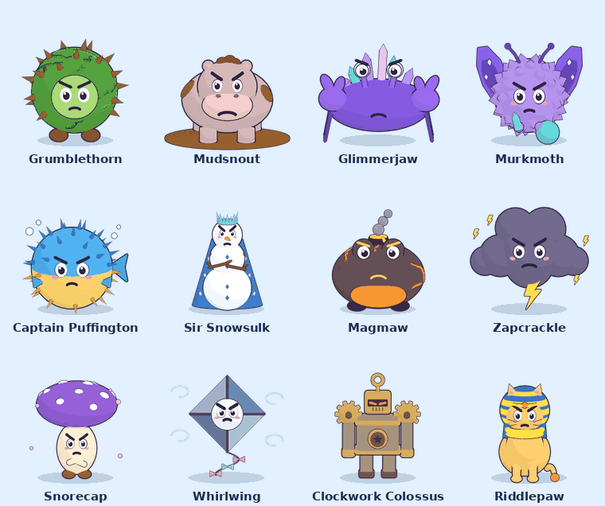
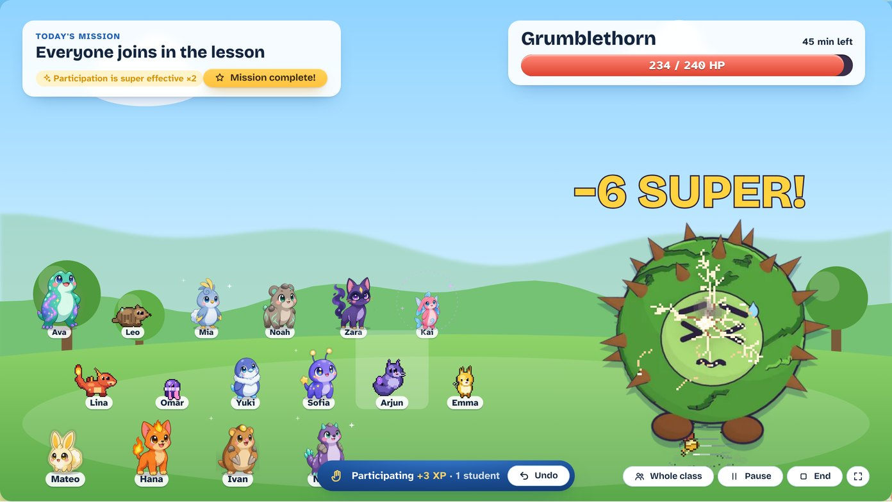
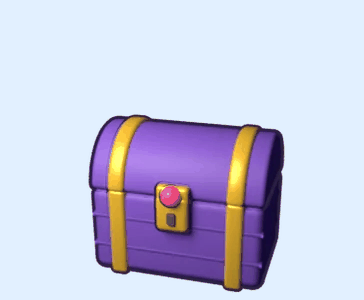

# Classroom Creatures 1.7.0: the bosses come alive

The twelve bosses are now animated 3D characters, and treasure chests burst open. Nothing about your classes,
battles or progress changes.

## New
- **Animated bosses.** Every boss was built as a 3D model in Blender, after its painting, and rendered into
  animation frames with SpriteCast. In the battle arena a boss now breathes and blinks while it waits, flinches
  every time a creature hits it, winds up and lunges when it strikes back, and hops for joy once the class
  befriends it, in its befriended look: Grumblethorn bursts into flowers, Captain Puffington puts on his hat and
  tucks his spikes away, Zapcrackle turns into a white cloud with a rainbow, Sir Snowsulk waves his stick arms and
  puts on a scarf.
- **Wandering bosses walk.** On a region's page, Mudsnout, Murkmoth and Zapcrackle stroll to and fro along a
  little lane.
- **The treasure chest bursts open.** The chest-opening moment is a 3D chest, also made in Blender, in its own
  colours: the lid flies up, light pours out, sparkles burst and it stays open on what was inside.
- **Pixel mode moves too.** In Pixel mode the bosses are drawn as pixel art from the same animation, so they
  breathe, flinch and hop as pixel sprites.

| In the arena | The chest opens |
|---|---|
|  |  |

## Settings
- **Settings → Adventure → Animated bosses** (on by default). Turn it off for the still painted drawings, for
  example on a very old computer. If the animation ever cannot load, the painted boss is shown instead.
- **Reduce motion** shows each boss as one still picture for its mood, and the chest simply appears open.

## For developers
- `scripts/bosses-3d/`: `kit.py` (modelling primitives, a dark inverted-hull outline baked into the geometry, the
  rig and clip writer), `common.py` (the shared face: eyes, brows, closed eyes and mouths for four moods, switched
  by scaling bones; the five clips), `bosses.py` (the twelve builders) and `build.py` run in headless Blender and
  export one GLB per boss with clips idle, walk, attack, hurt and happy. `specs.py` writes the SpriteCast specs
  (`"rig_glb"`, `"draw": false`, `"pitch": 12`), `render_all.sh` runs `charpipe.py render` and `finish` for each,
  and `export_sprites.py` packs the front-facing strips and the side walks into `public/bosses3d/<id>/*.webp`
  plus `src/data/bossSprites.json` (a stage per boss with the feet on one spot). `peek.py` is a quick front-only
  look through SpriteCast's renderer while a model is being shaped. `npm run art:bosses` does it all.
- `scripts/blender/chest.py` models, animates and renders the chest with Cycles (24 frames per kind);
  `pack_chests.py` makes `public/chests/<kind>.webp` and `src/data/chestSprites.json`. `npm run art:chests`.
- `src/creatures/bosses/BossSprite.tsx` plays a strip on a canvas (one-shots fall back to idle, a `beat` prop
  replays a hit; Pixel mode makes a crisp small copy of each strip once). `BossPortrait` chooses it or the
  painting; `WanderingBoss` walks a boss along a lane. The arena passes `beat` and stops its CSS breathing for
  animated bosses. `Settings.bossStyle` (`'animated' | 'painted'`) has no data migration: missing means animated.
- About 12 MB of new WebP art (11 MB of boss strips, 1 MB of chests). The generated models and renders live in `art/` (git-ignored).
- Tests: `src/engine/sprites.test.ts` checks every boss and chest strip against its manifest (sizes read from the
  WebP headers, feet on the stage's anchor); `npm run test:e2e:battle` now checks the boss flinches, lunges and
  hops; the new `npm run test:e2e:sprites` covers the boss list, the walking wandering boss, the painted setting,
  the chest opening and Pixel mode.
