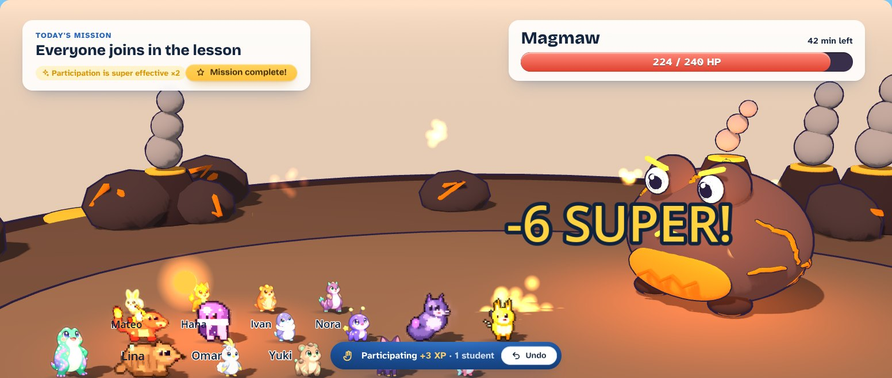
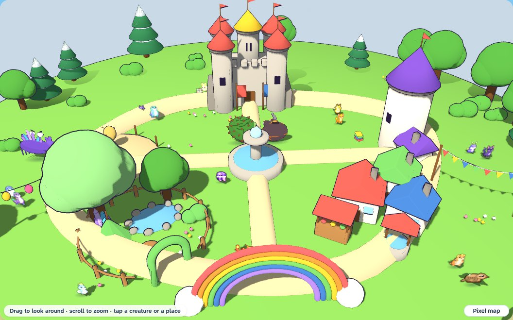
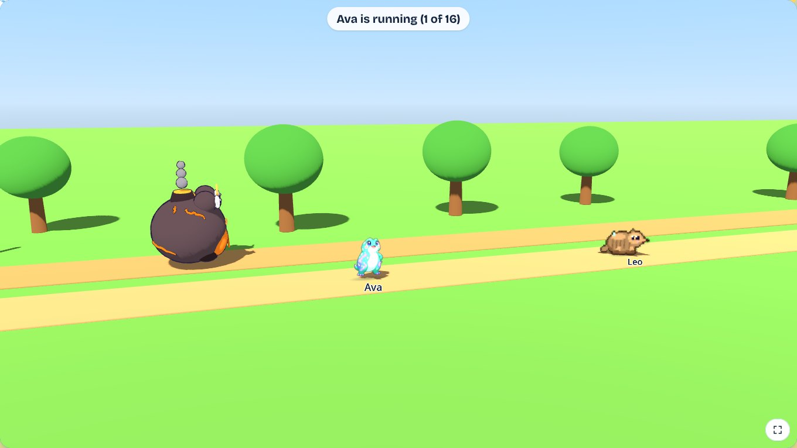
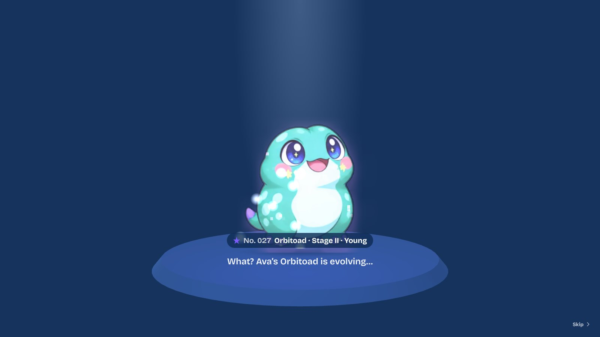

# Classroom Creatures 1.8.0: the 3D stage

The arena, the class world, three new class games and the evolution moment now play as 3D scenes made in Godot.
Your creatures come with them, outfits included, and move, glow and cast shadows. Nothing about your classes,
points or rewards changes: the app still runs every rule, and the 3D stage only draws what happened.

## New
- **A real-time 3D boss arena.** The 3D bosses stand in a 3D set for their region, nine in all, built in Blender:
  round trees in Verdant Valley, crystal clusters in the caverns, coral in the lagoon, snowy pines on Frostpeak,
  lava rocks and smoking vents in the Ember Kingdom, giant mushrooms, clouds and floating islands, broken pillars,
  dunes and a pyramid. When a creature attacks, it hops, the boss turns toward it, its element flies across the arena
  and bursts, and the camera shakes (and zooms in on a super-effective hit). A strike back flies the other way and
  leaves the creature dazed with stars. The HP bar moves at the moment of impact. Once the class befriends the boss,
  the camera comes in close while the boss hops for joy and every creature celebrates. Tap a creature to give points.
- **A class world you can walk around.** The Creature Sanctuary, Fantasy Village, Magical Library, Training Arena
  and Royal Castle stand on one island, each built in Blender at all three stages; when you build a stage it pops up
  with a puff of dust and sparkles. Every student's creature wanders the paths (they stop to greet each other with a
  puff of hearts), befriended bosses drop by and stroll round the island in all eight directions, and the earned
  decorations (bunting, lanterns, the wishing fountain, the rainbow arch) are there. Drag to look around, scroll to
  zoom, tap a creature to see whose it is, tap a place to open it. The pixel map is one tap away.
- **Class games** (new **Games** tab): short games for a brain break or a treat. Nobody is ranked and no points
  change.
  - **Class relay** (about a minute): every creature runs one leg, and each one's points today make its leg faster.
    The class races a boss as one team.
  - **Catch the stars** (one minute): one creature catches falling stars; pass the mouse round the class.
  - **Memory match** (two or three minutes): find the pairs of creatures from your field guide.
- **Creatures come alive in 3D** without any new art. One shader gives every painting, outfit included:
  breathing, swaying, hops, lunges, flinches, a happy wobble and a walk; its element on its own body (fire shimmers
  and flickers, water ripples with light, electric creatures crackle, ice glints, shadow creatures trail smoke,
  cosmic ones twinkle); a soft roundness from its own outline so the stage lights shade it; a shadow on the
  ground; and a shimmering aura for the mythical forms.
- **A bigger evolution moment.** Behind the evolution overlay the creature turns to light while its element swirls
  round it and a pillar of light rises, there is a flash, and it dissolves into its next form, which hops for joy.

| The class world | Class relay | Evolution |
|---|---|---|
|  |  |  |

## Settings
- **Settings → Classroom → 3D scenes** (on by default). Turn it off for the 2D arena, the pixel class world and the
  2D evolution, for example on a very old computer. If a computer cannot run the 3D stage (it needs WebGL 2), the app
  uses the 2D versions by itself. Pixel mode keeps its pixel arena.
- **Reduce motion** calms the 3D scenes (smaller movements, no camera shake or zooms) and keeps the 2D evolution.

## For developers
- `godot/` is a Godot 4.4 project (Compatibility renderer). `npm run stage` (`scripts/godot/export.mjs`) parses every
  script, then exports it for the web into `public/godot/` (no threads, so no special headers) and writes its
  settings to `config.json`. `public/godot/stage.html` + `stage.js` start it without inline script, under the desktop
  app's content policy, which now allows `'wasm-unsafe-eval'`. About 42 MB of engine and 37 MB of scenes.
- The bridge (`godot/scripts/Bridge.gd`, `src/components/GodotStage.tsx`): JSON over `postMessage`. The app sends
  `init`, `students`, `pictures`, moves (`attack`, `team`, `strike`) and state; the stage answers `ready`, `hit`,
  `done`, `tap`, `place`, `leg`, `score`, `pair`, `result`, `flash`, `revealed`. `GodotStage.play()` waits for a
  move's `done` and hears its `hit` on the way.
- Creatures: `src/lib/stage.ts` sends each student's painting at once and then, a few at a time, the creature in its
  outfit (`creaturePicture` in `pixelSprite.ts`, Pixel Pals from their sheets). `godot/shaders/creature.gdshader` and
  `godot/scripts/Creature3D.gd` do the rest.
- Scenes: `godot/scripts/scenes/` (Arena, World, Race, Stars, Memory, Evolution). Shared: `Toon.gd` (cartoon
  shading for the Blender models), `Fx.gd` (particles, shots, numbers), `Stage3D.gd` (sky and sun per region).
- Art: `scripts/bosses-3d/arenas.py` (the nine arena sets) and `world.py` (the island, 15 buildings, the plot, four
  decorations) in Blender; `visitors.py` packs each boss's walk and stand small and runs SpriteCast's own Godot
  exporter (`export.py`) into `godot/sprites/<id>/`; `scripts/godot/copy-bosses.mjs` brings in the boss models.
  `npm run art:stage` does it all.
- Tests: `npm run test:e2e:stage` (the arena in 3D with points and a strike back, the keyboard list, the 2D
  fallback, the class world and its pixel-map switch, all three games played through on short settings, the 3D
  evolution), with the desktop app's content policy on the stage's pages.
