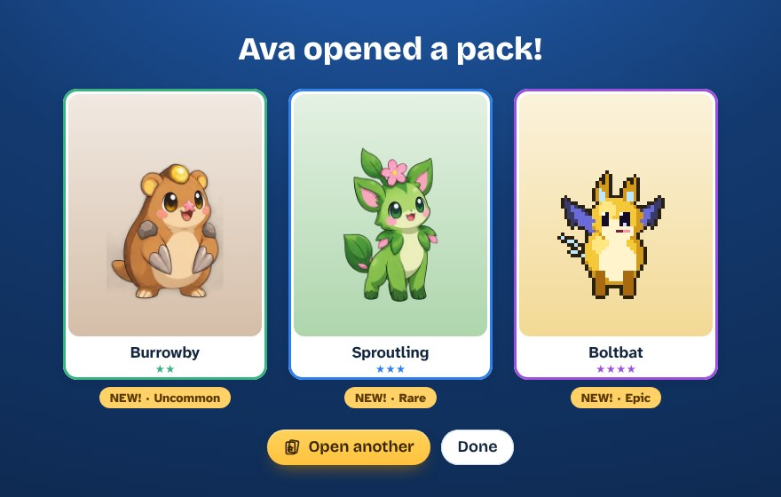
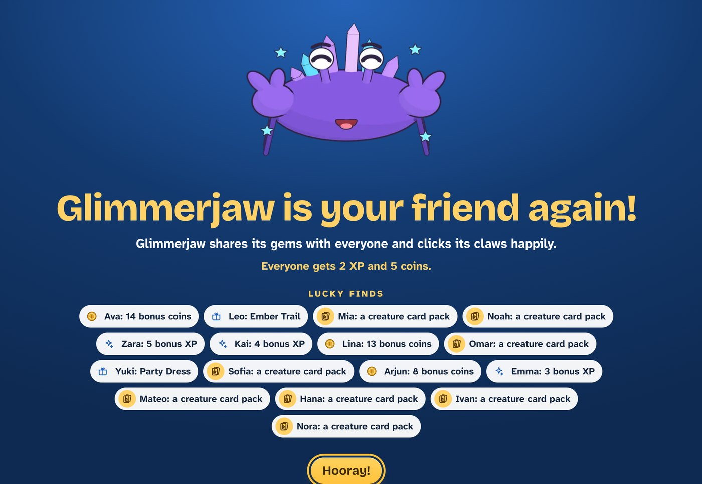
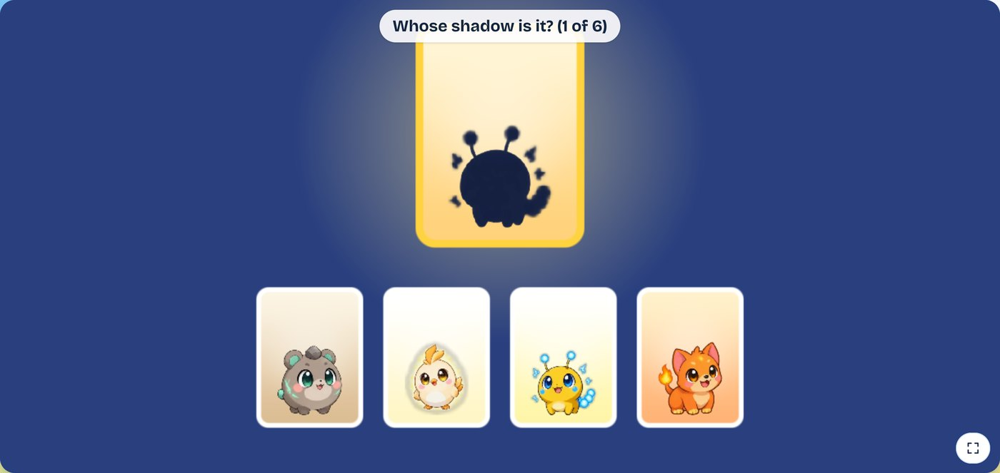
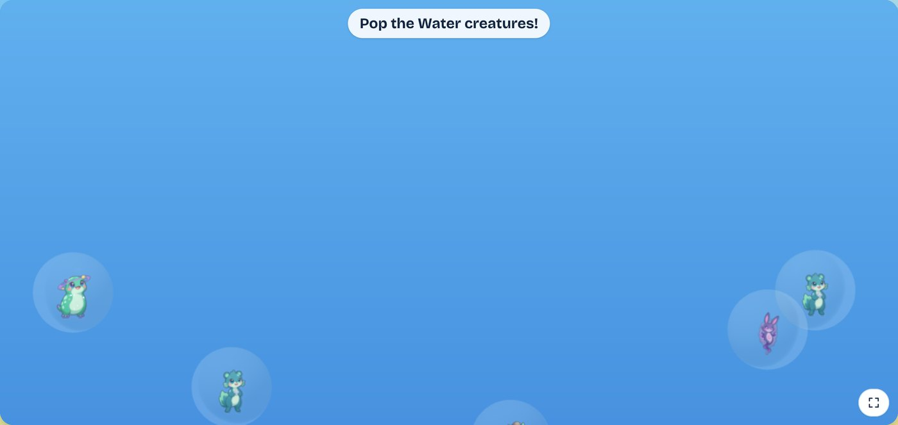

# Classroom Creatures 1.9.0: special attacks, card packs and more games

Every creature now has a special attack, and so does every boss. Befriending a boss gives each student a lucky
find. Coins buy creature card packs to collect in a binder. Two new class games join the Games tab, the memory match
has picture cards, and the 3D stage is faster and fits any screen.

## New
- **Special attacks.** Every 10 points a creature gives in a boss battle, it follows up with its element's special
  attack: it glows and powers up in a swirl of its element, then three big shots hit the boss for 5 more. Ember
  Storm, Bubble Surge, Bloom Burst, Spark Cascade, Frost Flurry, Boulder Roll, Moonshade Pounce, Dawn Ray, Starfall
  and Gale Spin.
- **The boss's special attack.** Each boss has its own (Lava Hiccup, Crystal Clatter, Bramble Storm and the rest).
  It fires once when the boss falls to half its HP and once at a quarter: a wave washes over the whole class, every
  creature flinches and the boss gets a little back. It never singles anyone out and never undoes a win. Lesson
  battles are sized up to match, so a battle still lasts about the lessons you planned.
- **Lucky finds.** When the class befriends a boss, every student also gets a random find, shown on the celebration:
  bonus coins, bonus XP, an outfit or accessory they do not have yet, or a creature card pack.
- **Creature card packs** (new **Cards** tab). A student spends coins on a pack of three creature cards (25 coins,
  or a free pack won from a boss) and collects them in a binder of every creature form: five stages of each painted
  creature, the mythical forms and the Pixel Pals, 210 cards in all. A card's rarity is its stage, the third card of
  every pack is Rare or better, and a copy they already have turns back into 2 coins. Cards you have not found yet
  show as silhouettes.
- **Two new class games.**
  - **Whose shadow?** A creature from your field guide hides as a dark shadow. The class calls out who it is, then
    you tap its picture and it steps out of the shadows. A wrong guess only wobbles.
  - **Element bubbles.** Bubbles float up with the class's own creatures inside. Pop the ones of the element on the
    screen; it changes every few seconds.
- **A new memory match.** Real picture cards: each creature's painting on a wash of its element colours, no words,
  and a starry card back. The table always fits the screen.

| Lucky finds | Whose shadow? | Element bubbles |
|---|---|---|
|  |  |  |

## Fixed
- **The 3D stage was slow and laggy on a Mac.** It drew every frame at twice the screen's resolution on Retina
  displays; it now draws at the normal resolution (four times fewer pixels), with a lighter creature shader and a
  smaller shadow map. Creatures without an outfit are drawn straight from their painting, so starting a boss fight
  does far less work.
- **Creatures had a square round them.** Each creature's card cast a rectangular shadow; creatures now have only their
  soft shadow on the ground, and their glow fades out instead of filling the picture.
- **Pictures were missing in the desktop app.** The 3D stage could not load the app's own creature paintings (the
  memory cards showed only names, and creatures appeared late). Every picture now reaches the stage directly.
- **The screen was trimmed.** The arena, the class world and the games now fit the window instead of running off the
  bottom on a laptop, and the memory table no longer cuts off cards at the sides.
- **Pixel mode.** The 3D scenes now draw as pixel art in Pixel mode, and the pixel arena fits the window too.

## Settings
- **Settings → Classroom → Creature card packs** (on by default) and the pack price.

## For developers
- `src/engine/cards.ts`: the card forms, odds and `openPack`. `rollLoot` and the special attacks are in
  `src/engine/adventure/bosses.ts` (`hitBoss`); the constants are `SPECIAL`, `ELEMENT_SPECIALS` and `BOSS_SPECIALS` in
  `src/data/adventure.ts`. New contribution sources: `special` and `boss-special`. Student fields `cards` and `packs`,
  battle field `loot`; no migration needed.
- Stage: `godot/shaders/card.gdshader` (picture cards), `scenes/Quiz.gd`, `scenes/Bubbles.gd`, the new `Memory.gd`;
  `special` and `boss_special` moves in `Arena.gd`; `pixel=1` renders a scene through a small `SubViewport`
  (`Main.gd`). Pictures always cross as data URLs (the engine's HTTP client cannot fetch `app://`).
  `src/lib/useFitHeight.ts` sizes scene boxes to the window.
- Tests: `src/engine/v19.test.ts`, `npm run test:e2e:cards`, and the stage test now covers special attacks, lucky
  finds and the two new games.
